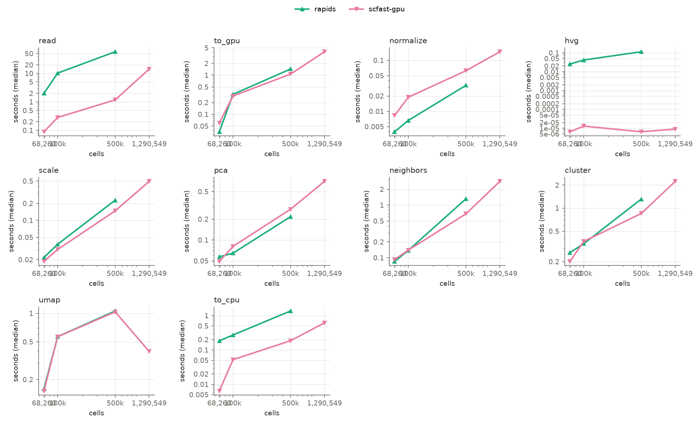
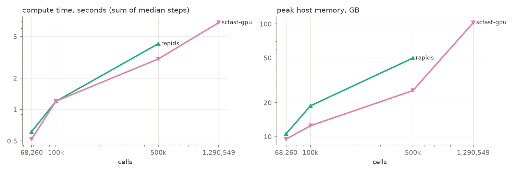

# Benchmark report: `gpu_h100_real`

Node `modal` · unknown · 32 logical CPUs · GPU: NVIDIA H100 80GB HBM3 · commit `unknown`

## End to end

Compute = normalise → UMAP (median of measured repeats, summed). Read and CPU⇄GPU transfers are shown separately. Speed-up and memory ratio are against Seurat at the same size; higher is better.

| Cells | Engine | Compute s | Read s | Transfer s | Peak RSS GB | Peak GPU GB | Speed-up | Memory ratio | PC sim | kNN overlap | ARI | Verdict |
|---:|---|---:|---:|---:|---:|---:|---:|---:|---:|---:|---:|---|
| 68,260 | rapids | 0.62 | 2.00 | 0.22 | 10.62 | 3.57 | –× | –× | 1.000 | 0.974 | 0.535 | fails parity |
| 68,260 | scfast-gpu | 0.52 | 0.09 | 0.07 | 9.52 | 2.26 | –× | –× | 1.000 | 0.994 | 0.727 | fails parity |
| 100,000 | rapids | 1.20 | 10.27 | 0.60 | 18.80 | 7.60 | –× | –× | 1.000 | 0.995 | 0.588 | fails parity |
| 100,000 | scfast-gpu | 1.20 | 0.28 | 0.35 | 12.52 | 2.97 | –× | –× | 1.000 | 0.996 | 0.548 | fails parity |
| 500,000 | rapids | 4.28 | 57.74 | 2.80 | 49.87 | 33.55 | –× | –× | 1.000 | 0.992 | 0.503 | fails parity |
| 500,000 | scfast-gpu | 3.06 | 1.18 | 1.25 | 25.67 | 10.20 | –× | –× | 1.000 | 0.994 | 0.476 | fails parity |
| 1,290,549 | scfast-gpu | 6.80 | 14.31 | 4.58 | 102.77 | 43.26 | –× | –× | – | – | – | no parity data |

Parity thresholds: PC similarity ≥ 0.99, kNN overlap ≥ 0.9, ARI ≥ 0.9. Adoption: parity passes and, at ≥ 100,000 cells, ≥ 1.5× faster or ≥ 2.0× less peak memory. Scanpy and rapids run their own pipelines (different HVG, graph and Leiden implementations), so their parity is informative only; the rule is meant for scfast.

## Agreement with known cell types

| Cells | Engine | ARI vs truth | Reference ARI vs truth |
|---:|---|---:|---:|
| 100,000 | rapids | – | – |
| 100,000 | scanpy | – | – |
| 100,000 | scfast-cpu | – | – |
| 100,000 | scfast-gpu | – | – |
| 500,000 | rapids | – | – |
| 500,000 | scanpy | – | – |
| 500,000 | scfast-cpu | – | – |
| 500,000 | scfast-gpu | – | – |
| 68,260 | rapids | 0.287 | 0.283 |
| 68,260 | scanpy | 0.258 | 0.283 |
| 68,260 | scfast-cpu | 0.270 | 0.283 |
| 68,260 | scfast-gpu | 0.265 | 0.283 |

## Per step

Median wall time in seconds (min–max over measured repeats); peak RSS within the step when the platform supports per-step peaks.

| Cells | Engine | Step | Median s | Min–max s | Repeats | Peak RSS GB | RSS scope |
|---:|---|---|---:|---:|---:|---:|---|
| 68,260 | rapids | read | 1.998 | 1.988–2.007 | 2 | 10.62 | process |
| 68,260 | rapids | to_gpu | 0.036 | 0.034–0.037 | 2 | 10.62 | process |
| 68,260 | rapids | normalize | 0.004 | 0.001–0.006 | 2 | 10.62 | process |
| 68,260 | rapids | hvg | 0.026 | 0.024–0.027 | 2 | 10.62 | process |
| 68,260 | rapids | scale | 0.022 | 0.021–0.022 | 2 | 10.62 | process |
| 68,260 | rapids | pca | 0.057 | 0.053–0.062 | 2 | 10.62 | process |
| 68,260 | rapids | neighbors | 0.085 | 0.081–0.090 | 2 | 10.62 | process |
| 68,260 | rapids | cluster | 0.263 | 0.257–0.268 | 2 | 10.62 | process |
| 68,260 | rapids | umap | 0.159 | 0.159–0.160 | 2 | 10.62 | process |
| 68,260 | rapids | to_cpu | 0.184 | 0.183–0.185 | 2 | 10.62 | process |
| 68,260 | scfast-gpu | read | 0.089 | 0.087–0.091 | 2 | 9.52 | process |
| 68,260 | scfast-gpu | to_gpu | 0.060 | 0.030–0.090 | 2 | 9.52 | process |
| 68,260 | scfast-gpu | normalize | 0.008 | 0.008–0.009 | 2 | 9.52 | process |
| 68,260 | scfast-gpu | hvg | 0.000 | 0.000–0.000 | 2 | 9.52 | process |
| 68,260 | scfast-gpu | scale | 0.019 | 0.018–0.020 | 2 | 9.52 | process |
| 68,260 | scfast-gpu | pca | 0.049 | 0.045–0.053 | 2 | 9.52 | process |
| 68,260 | scfast-gpu | neighbors | 0.093 | 0.092–0.093 | 2 | 9.52 | process |
| 68,260 | scfast-gpu | cluster | 0.201 | 0.200–0.203 | 2 | 9.52 | process |
| 68,260 | scfast-gpu | umap | 0.151 | 0.151–0.151 | 2 | 9.52 | process |
| 68,260 | scfast-gpu | to_cpu | 0.006 | 0.002–0.010 | 2 | 9.52 | process |
| 100,000 | rapids | read | 10.273 | 10.148–10.398 | 2 | 18.80 | process |
| 100,000 | rapids | to_gpu | 0.324 | 0.181–0.467 | 2 | 18.80 | process |
| 100,000 | rapids | normalize | 0.007 | 0.007–0.007 | 2 | 18.80 | process |
| 100,000 | rapids | hvg | 0.042 | 0.038–0.045 | 2 | 18.80 | process |
| 100,000 | rapids | scale | 0.038 | 0.036–0.039 | 2 | 18.80 | process |
| 100,000 | rapids | pca | 0.065 | 0.063–0.066 | 2 | 18.80 | process |
| 100,000 | rapids | neighbors | 0.138 | 0.131–0.145 | 2 | 18.80 | process |
| 100,000 | rapids | cluster | 0.342 | 0.336–0.349 | 2 | 18.80 | process |
| 100,000 | rapids | umap | 0.568 | 0.566–0.570 | 2 | 18.80 | process |
| 100,000 | rapids | to_cpu | 0.273 | 0.265–0.280 | 2 | 18.80 | process |
| 100,000 | scfast-gpu | read | 0.284 | 0.282–0.285 | 2 | 12.52 | process |
| 100,000 | scfast-gpu | to_gpu | 0.293 | 0.195–0.392 | 2 | 12.52 | process |
| 100,000 | scfast-gpu | normalize | 0.019 | 0.019–0.019 | 2 | 12.52 | process |
| 100,000 | scfast-gpu | hvg | 0.000 | 0.000–0.000 | 2 | 12.52 | process |
| 100,000 | scfast-gpu | scale | 0.030 | 0.028–0.032 | 2 | 12.52 | process |
| 100,000 | scfast-gpu | pca | 0.081 | 0.079–0.082 | 2 | 12.52 | process |
| 100,000 | scfast-gpu | neighbors | 0.140 | 0.136–0.143 | 2 | 12.52 | process |
| 100,000 | scfast-gpu | cluster | 0.367 | 0.354–0.379 | 2 | 12.52 | process |
| 100,000 | scfast-gpu | umap | 0.566 | 0.553–0.578 | 2 | 12.52 | process |
| 100,000 | scfast-gpu | to_cpu | 0.052 | 0.050–0.054 | 2 | 12.52 | process |
| 500,000 | rapids | read | 57.743 | 57.719–57.767 | 2 | 49.87 | process |
| 500,000 | rapids | to_gpu | 1.439 | 0.854–2.024 | 2 | 49.87 | process |
| 500,000 | rapids | normalize | 0.032 | 0.032–0.032 | 2 | 49.87 | process |
| 500,000 | rapids | hvg | 0.115 | 0.113–0.116 | 2 | 49.87 | process |
| 500,000 | rapids | scale | 0.229 | 0.213–0.244 | 2 | 49.87 | process |
| 500,000 | rapids | pca | 0.217 | 0.217–0.217 | 2 | 49.87 | process |
| 500,000 | rapids | neighbors | 1.317 | 1.304–1.331 | 2 | 49.87 | process |
| 500,000 | rapids | cluster | 1.309 | 1.295–1.323 | 2 | 49.87 | process |
| 500,000 | rapids | umap | 1.059 | 1.058–1.061 | 2 | 49.87 | process |
| 500,000 | rapids | to_cpu | 1.366 | 1.352–1.379 | 2 | 49.87 | process |
| 500,000 | scfast-gpu | read | 1.179 | 1.170–1.187 | 2 | 25.67 | process |
| 500,000 | scfast-gpu | to_gpu | 1.066 | 0.700–1.431 | 2 | 25.67 | process |
| 500,000 | scfast-gpu | normalize | 0.063 | 0.062–0.063 | 2 | 25.67 | process |
| 500,000 | scfast-gpu | hvg | 0.000 | 0.000–0.000 | 2 | 25.67 | process |
| 500,000 | scfast-gpu | scale | 0.148 | 0.148–0.148 | 2 | 25.67 | process |
| 500,000 | scfast-gpu | pca | 0.278 | 0.278–0.279 | 2 | 25.67 | process |
| 500,000 | scfast-gpu | neighbors | 0.682 | 0.674–0.691 | 2 | 25.67 | process |
| 500,000 | scfast-gpu | cluster | 0.850 | 0.849–0.852 | 2 | 25.67 | process |
| 500,000 | scfast-gpu | umap | 1.037 | 1.035–1.038 | 2 | 25.67 | process |
| 500,000 | scfast-gpu | to_cpu | 0.186 | 0.185–0.187 | 2 | 25.67 | process |
| 1,290,549 | scfast-gpu | read | 14.309 | 13.945–14.672 | 2 | 102.77 | process |
| 1,290,549 | scfast-gpu | to_gpu | 3.966 | 3.852–4.080 | 2 | 102.77 | process |
| 1,290,549 | scfast-gpu | normalize | 0.148 | 0.147–0.148 | 2 | 102.77 | process |
| 1,290,549 | scfast-gpu | hvg | 0.000 | 0.000–0.000 | 2 | 102.77 | process |
| 1,290,549 | scfast-gpu | scale | 0.493 | 0.485–0.501 | 2 | 102.77 | process |
| 1,290,549 | scfast-gpu | pca | 0.702 | 0.700–0.703 | 2 | 102.77 | process |
| 1,290,549 | scfast-gpu | neighbors | 2.831 | 2.822–2.840 | 2 | 102.77 | process |
| 1,290,549 | scfast-gpu | cluster | 2.234 | 2.232–2.235 | 2 | 102.77 | process |
| 1,290,549 | scfast-gpu | umap | 0.395 | 0.395–0.395 | 2 | 102.77 | process |
| 1,290,549 | scfast-gpu | to_cpu | 0.617 | 0.600–0.633 | 2 | 102.77 | process |

## Start-up (cold)

| Engine | Cells | Start-up s |
|---|---:|---:|
| rapids | 68,260 | 7.13 |
| scfast-gpu | 68,260 | 5.65 |
| rapids | 100,000 | 6.44 |
| scfast-gpu | 100,000 | 7.70 |
| rapids | 500,000 | 4.50 |
| scfast-gpu | 500,000 | 5.95 |
| rapids | 1,290,549 | 4.45 |
| scfast-gpu | 1,290,549 | 136.82 |

## Failures

| Engine | Cells | Step | Error |
|---|---:|---|---|
| rapids | 1,290,549 | normalize | MemoryError: std::bad_alloc: out_of_memory: CUDA error (failed to allocate 20915333976 bytes) at: /__w/rmm/rmm/cpp/src/mr/cuda_async_view_memory_resource.cpp:43 |

## Scaling

Plotted values are in `summary_steps.csv` and `summary_totals.csv`.
