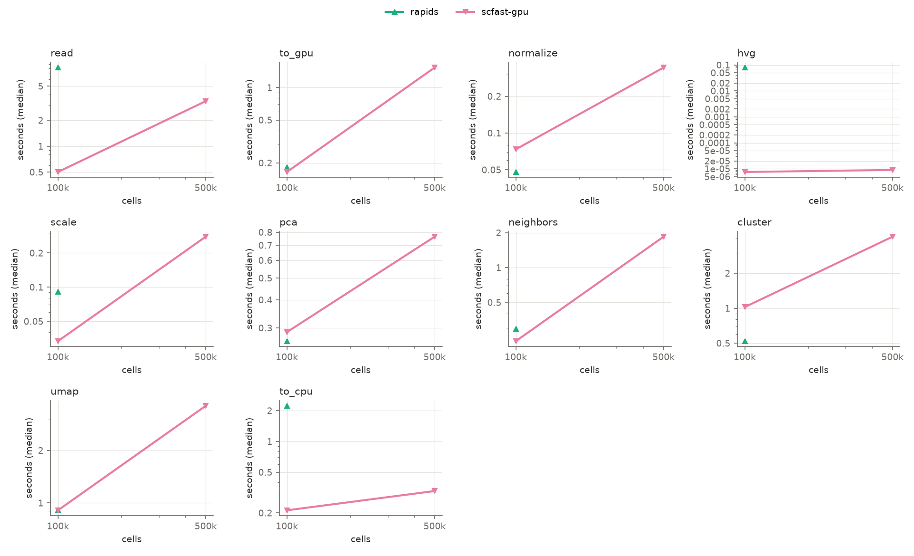
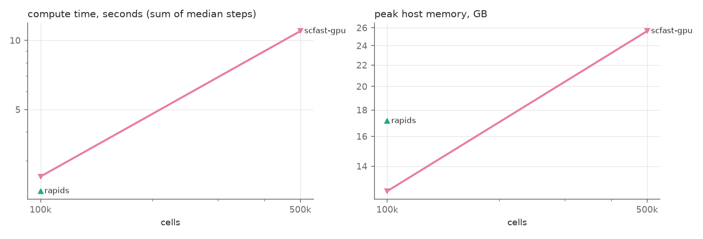

# Benchmark report: `gpu_l4_real`

Node `modal` · unknown · 21 logical CPUs · GPU: NVIDIA L4 · commit `unknown`

## End to end

Compute = normalise → UMAP (median of measured repeats, summed). Read and CPU⇄GPU transfers are shown separately. Speed-up and memory ratio are against Seurat at the same size; higher is better.

| Cells | Engine | Compute s | Read s | Transfer s | Peak RSS GB | Peak GPU GB | Speed-up | Memory ratio | PC sim | kNN overlap | ARI | Verdict |
|---:|---|---:|---:|---:|---:|---:|---:|---:|---:|---:|---:|---|
| 100,000 | rapids | 2.21 | 8.22 | 2.41 | 17.14 | 6.83 | –× | –× | 1.000 | 0.995 | 0.606 | fails parity |
| 100,000 | scfast-gpu | 2.56 | 0.50 | 0.38 | 12.52 | 2.19 | –× | –× | 1.000 | 0.996 | 0.600 | fails parity |
| 500,000 | scfast-gpu | 10.97 | 3.34 | 1.86 | 25.62 | 9.42 | –× | –× | 1.000 | 0.994 | 0.536 | fails parity |

Parity thresholds: PC similarity ≥ 0.99, kNN overlap ≥ 0.9, ARI ≥ 0.9. Adoption: parity passes and, at ≥ 100,000 cells, ≥ 1.5× faster or ≥ 2.0× less peak memory. Scanpy and rapids run their own pipelines (different HVG, graph and Leiden implementations), so their parity is informative only; the rule is meant for scfast.

## Per step

Median wall time in seconds (min–max over measured repeats); peak RSS within the step when the platform supports per-step peaks.

| Cells | Engine | Step | Median s | Min–max s | Repeats | Peak RSS GB | RSS scope |
|---:|---|---|---:|---:|---:|---:|---|
| 100,000 | rapids | read | 8.223 | 8.105–8.340 | 2 | 17.14 | process |
| 100,000 | rapids | to_gpu | 0.183 | 0.166–0.200 | 2 | 17.14 | process |
| 100,000 | rapids | normalize | 0.048 | 0.048–0.048 | 2 | 17.14 | process |
| 100,000 | rapids | hvg | 0.079 | 0.077–0.082 | 2 | 17.14 | process |
| 100,000 | rapids | scale | 0.091 | 0.085–0.097 | 2 | 17.14 | process |
| 100,000 | rapids | pca | 0.262 | 0.261–0.263 | 2 | 17.14 | process |
| 100,000 | rapids | neighbors | 0.296 | 0.292–0.301 | 2 | 17.14 | process |
| 100,000 | rapids | cluster | 0.521 | 0.519–0.522 | 2 | 17.14 | process |
| 100,000 | rapids | umap | 0.912 | 0.909–0.915 | 2 | 17.14 | process |
| 100,000 | rapids | to_cpu | 2.228 | 2.218–2.238 | 2 | 17.14 | process |
| 100,000 | scfast-gpu | read | 0.502 | 0.499–0.504 | 2 | 12.52 | process |
| 100,000 | scfast-gpu | to_gpu | 0.165 | 0.163–0.166 | 2 | 12.52 | process |
| 100,000 | scfast-gpu | normalize | 0.074 | 0.074–0.074 | 2 | 12.52 | process |
| 100,000 | scfast-gpu | hvg | 0.000 | 0.000–0.000 | 2 | 12.52 | process |
| 100,000 | scfast-gpu | scale | 0.033 | 0.033–0.034 | 2 | 12.52 | process |
| 100,000 | scfast-gpu | pca | 0.287 | 0.287–0.288 | 2 | 12.52 | process |
| 100,000 | scfast-gpu | neighbors | 0.231 | 0.229–0.234 | 2 | 12.52 | process |
| 100,000 | scfast-gpu | cluster | 1.024 | 1.019–1.029 | 2 | 12.52 | process |
| 100,000 | scfast-gpu | umap | 0.907 | 0.902–0.913 | 2 | 12.52 | process |
| 100,000 | scfast-gpu | to_cpu | 0.212 | 0.212–0.212 | 2 | 12.52 | process |
| 500,000 | scfast-gpu | read | 3.342 | 3.330–3.355 | 2 | 25.62 | process |
| 500,000 | scfast-gpu | to_gpu | 1.533 | 1.378–1.687 | 2 | 25.62 | process |
| 500,000 | scfast-gpu | normalize | 0.344 | 0.343–0.346 | 2 | 25.62 | process |
| 500,000 | scfast-gpu | hvg | 0.000 | 0.000–0.000 | 2 | 25.62 | process |
| 500,000 | scfast-gpu | scale | 0.278 | 0.278–0.279 | 2 | 25.62 | process |
| 500,000 | scfast-gpu | pca | 0.764 | 0.763–0.766 | 2 | 25.62 | process |
| 500,000 | scfast-gpu | neighbors | 1.850 | 1.839–1.861 | 2 | 25.62 | process |
| 500,000 | scfast-gpu | cluster | 4.136 | 4.128–4.143 | 2 | 25.62 | process |
| 500,000 | scfast-gpu | umap | 3.601 | 3.591–3.610 | 2 | 25.62 | process |
| 500,000 | scfast-gpu | to_cpu | 0.327 | 0.320–0.335 | 2 | 25.62 | process |

## Start-up (cold)

| Engine | Cells | Start-up s |
|---|---:|---:|
| scfast-gpu | 100,000 | 8.31 |
| rapids | 100,000 | 5.50 |
| scfast-gpu | 500,000 | 10.59 |
| rapids | 500,000 | 7.30 |

## Failures

| Engine | Cells | Step | Error |
|---|---:|---|---|
| rapids | 500,000 | normalize | MemoryError: std::bad_alloc: out_of_memory: CUDA error (failed to allocate 4051249884 bytes) at: /__w/rmm/rmm/cpp/src/mr/cuda_async_view_memory_resource.cpp:43: |

## Scaling

Plotted values are in `summary_steps.csv` and `summary_totals.csv`.
