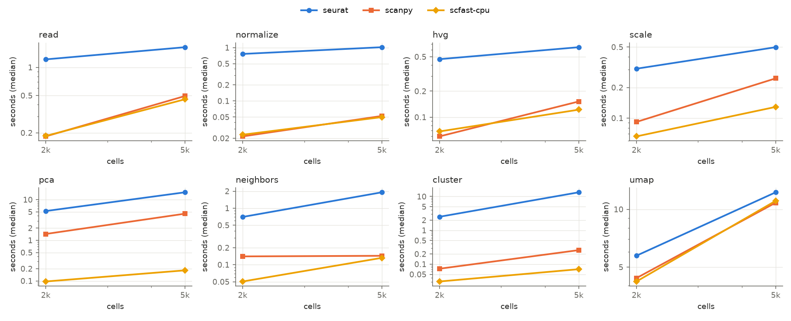
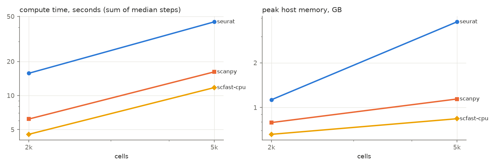

# Benchmark report: `synth_2k5k`

Node `vm` · Intel(R) Xeon(R) Processor @ 2.80GHz · 2 logical CPUs · GPU: none · commits `8819692`, `a80cf3c`

**Warning:** records in this run come from more than one commit, so engines may not have run the same harness code. Rerun on a single commit for publishable numbers.

Seurat 5.0.1 Leiden backend: leidenalg via reticulate. Seurat 5.0.x builds a dense cells × cells matrix for Leiden, which inflates its cluster-step time and memory; compare cluster-step numbers with care.

## End to end

Compute = normalise → UMAP (median of measured repeats, summed). Read and CPU⇄GPU transfers are shown separately. Speed-up and memory ratio are against Seurat at the same size; higher is better.

| Cells | Engine | Compute s | Read s | Transfer s | Peak RSS GB | Peak GPU GB | Speed-up | Memory ratio | PC sim | kNN overlap | ARI | Verdict |
|---:|---|---:|---:|---:|---:|---:|---:|---:|---:|---:|---:|---|
| 2,000 | seurat | 15.73 | 1.22 | 0.00 | 1.13 | – | 1.00× | 1.00× | – | – | – | baseline |
| 2,000 | scanpy | 6.20 | 0.18 | 0.00 | 0.79 | – | 2.54× | 1.42× | 1.000 | 0.996 | 1.000 | parity ok; too small to judge (< 100,000 cells) |
| 2,000 | scfast-cpu | 4.54 | 0.19 | 0.00 | 0.66 | – | 3.46× | 1.71× | 0.867 | 0.397 | 1.000 | fails parity |
| 5,000 | seurat | 44.79 | 1.64 | 0.00 | 3.77 | – | 1.00× | 1.00× | – | – | – | baseline |
| 5,000 | scanpy | 16.19 | 0.49 | 0.00 | 1.14 | – | 2.77× | 3.31× | 1.000 | 0.994 | 1.000 | parity ok; too small to judge (< 100,000 cells) |
| 5,000 | scfast-cpu | 11.76 | 0.46 | 0.00 | 0.84 | – | 3.81× | 4.49× | 0.888 | 0.326 | 1.000 | fails parity |

Parity thresholds: PC similarity ≥ 0.99, kNN overlap ≥ 0.9, ARI ≥ 0.9. Adoption: parity passes and, at ≥ 100,000 cells, ≥ 1.5× faster or ≥ 2.0× less peak memory. Scanpy and rapids run their own pipelines (different HVG, graph and Leiden implementations), so their parity is informative only; the rule is meant for scfast.

**Note on scfast parity (this run):** the top signal PCs match Seurat at 0.99998 (top 5), and clustering agrees exactly (ARI 1.0 vs Seurat and vs the planted types). The PC-similarity and kNN-overlap shortfalls come from PCs 9-10, which lie in this dataset's flat noise bulk, and from Seurat's `scale.max = 10` clipping, which the implicit PCA does not apply: with PCA accuracy pushed to convergence (power_iters 30+) similarity plateaus at 0.9875 and kNN overlap at 0.68, the clipping limit. Synthetic Gaussian blobs are a worst case for neighbour stability (within-cluster neighbours are pure noise); on the real-data fixture scfastR measured 99.9% kNN overlap with Seurat. Follow-up in docs/RUST_ENGINE.md: apply the clip exactly as a sparse correction.

## Agreement with known cell types

| Cells | Engine | ARI vs truth | Reference ARI vs truth |
|---:|---|---:|---:|
| 2,000 | scanpy | 1.000 | 1.000 |
| 2,000 | scfast-cpu | 1.000 | 1.000 |
| 5,000 | scanpy | 1.000 | 1.000 |
| 5,000 | scfast-cpu | 1.000 | 1.000 |

## Per step

Median wall time in seconds (min–max over measured repeats); peak RSS within the step when the platform supports per-step peaks.

| Cells | Engine | Step | Median s | Min–max s | Repeats | Peak RSS GB | RSS scope |
|---:|---|---|---:|---:|---:|---:|---|
| 2,000 | seurat | read | 1.216 | 0.981–1.272 | 3 | 0.88 | step |
| 2,000 | seurat | normalize | 0.761 | 0.737–0.867 | 3 | 0.88 | step |
| 2,000 | seurat | hvg | 0.469 | 0.420–0.490 | 3 | 0.88 | step |
| 2,000 | seurat | scale | 0.306 | 0.303–0.320 | 3 | 0.88 | step |
| 2,000 | seurat | pca | 5.241 | 4.743–5.293 | 3 | 0.88 | step |
| 2,000 | seurat | neighbors | 0.700 | 0.699–0.745 | 3 | 0.88 | step |
| 2,000 | seurat | cluster | 2.516 | 2.502–2.993 | 3 | 1.13 | step |
| 2,000 | seurat | umap | 5.733 | 5.622–6.075 | 3 | 1.01 | step |
| 2,000 | scanpy | read | 0.183 | 0.180–0.190 | 3 | 0.63 | step |
| 2,000 | scanpy | normalize | 0.022 | 0.021–0.023 | 3 | 0.65 | step |
| 2,000 | scanpy | hvg | 0.060 | 0.058–0.061 | 3 | 0.65 | step |
| 2,000 | scanpy | scale | 0.092 | 0.088–0.094 | 3 | 0.70 | step |
| 2,000 | scanpy | pca | 1.428 | 1.263–1.546 | 3 | 0.79 | step |
| 2,000 | scanpy | neighbors | 0.140 | 0.129–0.141 | 3 | 0.73 | step |
| 2,000 | scanpy | cluster | 0.073 | 0.073–0.082 | 3 | 0.73 | step |
| 2,000 | scanpy | umap | 4.383 | 4.171–4.771 | 3 | 0.73 | step |
| 2,000 | scfast-cpu | read | 0.185 | 0.163–0.227 | 3 | 0.64 | step |
| 2,000 | scfast-cpu | normalize | 0.023 | 0.021–0.029 | 3 | 0.66 | step |
| 2,000 | scfast-cpu | hvg | 0.068 | 0.058–0.073 | 3 | 0.66 | step |
| 2,000 | scfast-cpu | scale | 0.066 | 0.054–0.070 | 3 | 0.66 | step |
| 2,000 | scfast-cpu | pca | 0.097 | 0.093–0.120 | 3 | 0.66 | step |
| 2,000 | scfast-cpu | neighbors | 0.050 | 0.050–0.055 | 3 | 0.66 | step |
| 2,000 | scfast-cpu | cluster | 0.031 | 0.026–0.042 | 3 | 0.66 | step |
| 2,000 | scfast-cpu | umap | 4.208 | 3.957–4.344 | 3 | 0.66 | step |
| 5,000 | seurat | read | 1.640 | 1.639–1.881 | 3 | 1.25 | step |
| 5,000 | seurat | normalize | 1.018 | 0.833–1.087 | 3 | 1.25 | step |
| 5,000 | seurat | hvg | 0.645 | 0.644–0.684 | 3 | 1.25 | step |
| 5,000 | seurat | scale | 0.498 | 0.485–0.665 | 3 | 1.32 | step |
| 5,000 | seurat | pca | 15.158 | 15.020–16.523 | 3 | 1.48 | step |
| 5,000 | seurat | neighbors | 1.910 | 1.847–2.412 | 3 | 1.48 | step |
| 5,000 | seurat | cluster | 13.302 | 11.593–15.546 | 3 | 3.77 | step |
| 5,000 | seurat | umap | 12.261 | 12.170–12.644 | 3 | 2.79 | step |
| 5,000 | scanpy | read | 0.494 | 0.462–0.504 | 3 | 0.78 | step |
| 5,000 | scanpy | normalize | 0.052 | 0.043–0.060 | 3 | 0.82 | step |
| 5,000 | scanpy | hvg | 0.152 | 0.137–0.164 | 3 | 0.82 | step |
| 5,000 | scanpy | scale | 0.246 | 0.228–0.252 | 3 | 0.94 | step |
| 5,000 | scanpy | pca | 4.511 | 4.011–5.038 | 3 | 1.14 | step |
| 5,000 | scanpy | neighbors | 0.144 | 0.137–0.185 | 3 | 0.90 | step |
| 5,000 | scanpy | cluster | 0.260 | 0.210–0.307 | 3 | 0.91 | step |
| 5,000 | scanpy | umap | 10.824 | 9.905–10.850 | 3 | 0.75 | step |
| 5,000 | scfast-cpu | read | 0.456 | 0.407–0.549 | 3 | 0.80 | step |
| 5,000 | scfast-cpu | normalize | 0.050 | 0.043–0.105 | 3 | 0.84 | step |
| 5,000 | scfast-cpu | hvg | 0.122 | 0.117–0.148 | 3 | 0.84 | step |
| 5,000 | scfast-cpu | scale | 0.129 | 0.116–0.148 | 3 | 0.84 | step |
| 5,000 | scfast-cpu | pca | 0.182 | 0.176–0.182 | 3 | 0.84 | step |
| 5,000 | scfast-cpu | neighbors | 0.132 | 0.127–0.133 | 3 | 0.84 | step |
| 5,000 | scfast-cpu | cluster | 0.071 | 0.065–0.082 | 3 | 0.84 | step |
| 5,000 | scfast-cpu | umap | 11.070 | 9.797–11.129 | 3 | 0.84 | step |

## Start-up (cold)

| Engine | Cells | Start-up s |
|---|---:|---:|
| seurat | 2,000 | 7.74 |
| scanpy | 2,000 | 2.85 |
| scfast-cpu | 2,000 | 2.96 |
| seurat | 5,000 | 7.23 |
| scanpy | 5,000 | 3.41 |
| scfast-cpu | 5,000 | 3.68 |

## Scaling

Plotted values are in `summary_steps.csv` and `summary_totals.csv`.
