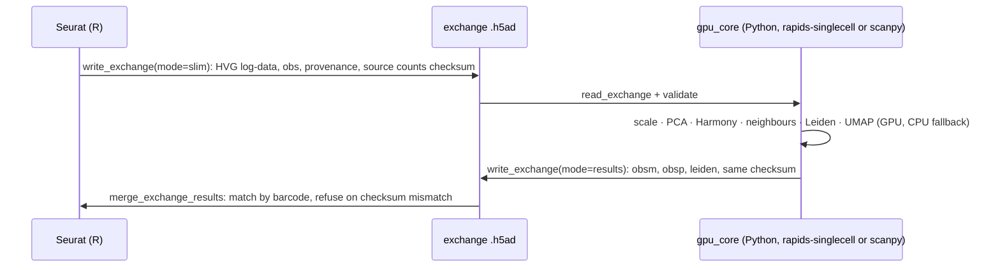
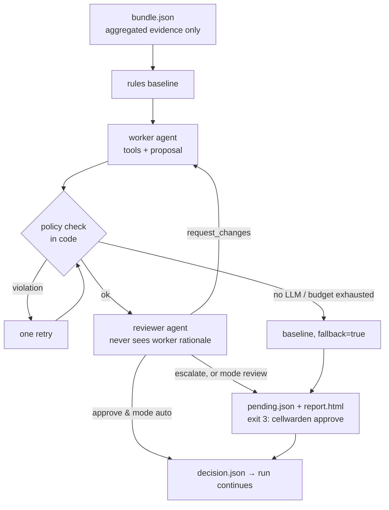

# CellWarden architecture (as built)

How the pipeline is put together, as implemented on `main`. [`DESIGN.md`](DESIGN.md) is the
design that preceded it and keeps the reasoning and open questions; this page describes what
exists. The three contracts the code follows are [`exchange-spec.md`](exchange-spec.md)
(Seurat ⇄ AnnData), [`stages-spec.md`](stages-spec.md) (S0–S2, the runner) and
[`agents-spec.md`](agents-spec.md) (gates, agents, S3–S5, portability).

## 1. One sentence

A single-cell RNA-seq pipeline with **Seurat as the backbone**, **GPU steps through a
validated exchange format**, and **LLM agents that advise at four review gates while rules,
a reviewer agent and humans keep the final say** — built to run on one internet-connected
node (first target: the Iridis X L4 login node) and to move to any HPC with one site file.

> Rules decide, agents advise, reviewers check, humans approve, everything is logged.

## 2. The pipeline

```mermaid
flowchart LR
  subgraph ingest["S0 ingest (R)"]
    S0[any format → one Seurat object]
  end
  subgraph qc["S1 QC"]
    S1a[S1a metrics R<br/>+ doublets on Rust path] --> S1b[S1b doublets py<br/>pass-through on Rust path] --> S1c[S1c rules engine py]
  end
  G1{{G1 QC gate}}
  subgraph core["S2 core processing"]
    S2[normalise · HVG · PCA · Harmony · neighbours · Leiden · UMAP<br/>CPU: Rust scfast in process (default) or Seurat · GPU: rapids-singlecell via exchange]
  end
  subgraph ev["S3 evidence"]
    S3[markers · signatures · CellTypist · consensus annotation]
  end
  G2{{G2 context gate}} --> G3{{G3 annotation gate}}
  subgraph dge["S4 DGE"]
    S4[pseudobulk DESeq2 / limma-voom<br/>Open Targets evidence]
  end
  G4{{G4 interpretation gate}}
  S5[S5 report.html · explorer.html]
  S0 --> S1a
  S1c --> G1 --> S2 --> S3 --> G2
  G3 --> S4 --> G4 --> S5
```

| Stage | Language | Reads | Writes | Notes |
|---|---|---|---|---|
| S0 ingest | R | `samples.csv`, 10x h5 / mtx, h5ad, loom, csv/tsv, Seurat rds/qs2 | `S0/object.rds`, `ingest_report.json` | Format auto-detected; gene union; non-integer counts refused; human-gene check |
| S1a metrics | R | S0 | `S1/qc_metrics.tsv.gz`, `metrics_counts.h5ad` | genes, UMIs, % mito/ribo/hb, protected-population scores |
| S1b doublets | Python | S1a | `qc_metrics.tsv.gz` (+ doublet score, pre-cluster) | Seurat/GPU path: scrublet per sample. Rust path: S1a already wrote score, call and pre-cluster, S1b passes through |
| S1c rules | Python | S1a/b, `qc_policy.yaml` | `S1/qc_decisions.tsv.gz`, `qc_summary.json` | hard limits → adaptive MAD bounds → doublets → protected rescue → review triggers; reason codes per cell |
| **G1** QC gate | Python | S1, policy | `gates/G1/*`, may rewrite `qc_decisions.tsv.gz` | agent may only *tighten* within policy; decisions re-applied through the rules engine |
| S2 core | R (+ Python on GPU) | S0, decisions | `S2/object.rds`, `summary.json` | device plan from free GPU memory. CPU + `scfastR`: `cpu_scfast`, all in process. GPU: exchange slim → `gpu_core` → results merged back by barcode and checksum |
| S3 evidence | R + Python | S2 | `S3/markers.tsv.gz`, `cluster_summary.json`, `signatures.tsv.gz`, `celltypist.tsv.gz`, `annotation_consensus.tsv`, `evidence_bundle.json` | consensus = weighted vote of signatures, CellTypist and markers against 72 human cell types with CL IDs |
| **G2** context | Python | S3 bundle | `gates/G2/*` | tissue (UBERON) and disease candidates (EFO) — speculative, so `review` by default |
| **G3** annotation | Python | S3 bundle, consensus | `gates/G3/*` → `S3/annotation.tsv` | agent may relabel only `low_confidence` / `conflict` clusters |
| S4 DGE | R + Python | S2, labels, `dge:` config | `S4/pseudobulk/`, `dge/*.tsv.gz`, `dge_summary.json`, `opentargets_summary.json` | `AggregateExpression` pseudobulk per sample × group; DESeq2 (limma-voom fallback with median-of-ratios sizes); up/down from *our* data, evidence from Open Targets |
| **G4** interpretation | Python | S4 summaries | `gates/G4/*` | every statement a labelled hypothesis citing Open Targets evidence IDs that must exist |
| S5 report | R + Python | everything | `S5/report.html`, `explorer.html`, `umap.tsv.gz` | self-contained HTML, no CDN; explorer subsamples above 100k cells |

### The runner

`cellwarden` (Python, `python/cellwarden/runner.py`) runs the stages in order, each as a separate
process under `nice` with thread, memory and GPU-memory caps passed as environment variables.
`state.json` records, per stage, status, timings, peak RSS and a **fingerprint** of the config
keys and input files that stage uses, so `cellwarden run` again skips finished stages and a config
change reruns only the stages that depend on it. A gate that needs a human exits with code 3;
`cellwarden approve` records the decision and `cellwarden resume` carries on. `--detach` runs inside
tmux (or nohup) so a dropped SSH session doesn't kill the run. After every state change the runner
rewrites `dashboard.html` (`python/cellwarden/dashboard.py`): a self-contained page with the pipeline
strip, a timeline and a card per stage and gate, built only from `state.json`, the stage summaries
and the gate files.

## 3. Engines and CPU ⇄ GPU switching

`engine` (`auto`, `scfast`, `seurat`) and `device` together choose the path. The Rust engine
(`scfast`, [`RUST_ENGINE.md`](RUST_ENGINE.md), wiring in [`scfast-integration.md`](scfast-integration.md))
has a CUDA backend that is not yet validated on hardware, so:

| plan | `engine: auto` (+ `engine_gpu: auto`) picks | path in `S2/summary.json` | exchange files |
|---|---|---|---|
| CPU, `scfastR` installed | scfast | `cpu_scfast` | none |
| CPU, no `scfastR` | seurat | `cpu_seurat` | none |
| GPU fits, `scfastR` built with CUDA and a device visible | scfast (CUDA) | `gpu_scfast` | none |
| GPU fits, otherwise | seurat + rapids | `gpu_exchange` (rapids-singlecell) | yes, as below |

The Rust engine (`rust/`): `scfast-core` (fused preprocessing, implicit-scaled randomised-SVD PCA,
exact kNN, SNN, Leiden via single-clustering), optional feature `cuda` (cudarc, NVRTC kernels for
the sparse products and top-k, cuBLAS; loaded at runtime so the crate builds without the toolkit)
and feature `cugraph` (cuGraph Leiden through its C API, also loaded at runtime), with the R
package `scfastR` (extendr) and the Python module `scfast` (PyO3). The CUDA and cuGraph paths are
compiled and unit-tested without hardware; their parity tests are `#[ignore]` and run on the L4.

On the Rust path S1a computes doublet scores and pre-clusters in R (`R/stages/doublets_scfast.R`),
S2 runs `RunPCAFast`, `FindNeighborsFast`, `FindClustersFast` and `RunUMAPFast` in process, and
Python `gpu_core --engine rust` offers the same kernels for the exchange route. The exchange below
is used only when the GPU does the work.



The exchange format (`R/exchange/exchange.R`, `python/cellwarden/exchange.py`) is a plain AnnData
file with a provenance block. Its **counts checksum** (SHA-256 over the canonical CSR arrays)
is computed identically in both languages, so results can never be merged into the wrong
object; cells are matched by barcode, never by position. Three modes: `full` (whole object),
`slim` (only what the GPU step needs), `results` (what comes back). `S2/summary.json` records
the device, the memory plan (`in_memory`, `managed_memory`, `cpu`) and why.

## 4. Gates, agents, reviewer, humans



Each gate directory holds `bundle.json`, `proposal.json`, `review.json`, `decision.json`,
`report.html` (and `pending.json` while waiting). What the agents can do is bounded in code:

- **G1** may propose thresholds only inside the policy's hard limits and only tighter; the
  accepted thresholds are re-applied by the same rules engine, with the original decisions kept
  as a baseline file.
- **G3** may relabel only clusters the consensus marked low-confidence or conflicting, with
  labels from the cell-type table.
- **G4** may cite only evidence IDs present in `opentargets_summary.json` and genes with the
  direction our DGE found; every sentence is labelled a hypothesis.
- Sample metadata reaches a prompt only inside `<data>` tags that the system prompt declares
  are never instructions.

**LLM adapter** (`python/cellwarden/llm/`): one `Provider` interface with `anthropic`,
`openai_compatible` (vLLM, Ollama, …), `mock` (tests) and stubs for `bedrock`/`vertex`. The
default model is Claude Haiku 4.5, overridable per role. The **budget ledger** prices every call
and refuses any call that would cross the per-run (£5) or total (£30) limit; the gate then falls
back to the rules baseline and waits for a human. `llm/agent_log.jsonl` holds every call with
prompt and input hashes, so `replay: true` reproduces a run without API calls. API keys are read
from an environment variable named in the config and never written anywhere.

## 5. Portability

- **One config file** (`config.yaml`) plus `samples.csv` and `qc_policy.yaml`; every setting
  validated up front, all problems reported at once.
- **Site file** (`conf/sites/<site>.yaml`) supplies `execution`, `resources`, `container` and
  scratch defaults; `cellwarden init-site` drafts one by detecting the scheduler, GPU, container
  runtime and internet access. `cellwarden doctor` checks packages, GPU, write access, the LLM key
  and a one-token tool-use call, the budget left, and Open Targets.
- **Execution modes:** `direct` (the node you are on, the Iridis X login-node case),
  `slurm`/`pbs`/`lsf`/`sge` (one job from `conf/templates/`), `split` (heavy stages as an
  offline job, gates and Open Targets on the internet node).
- **Containers:** `containers/cellwarden.def` (Apptainer) and `Dockerfile`, same software list.
- **Shared-node etiquette:** thread/RAM/GPU caps, `nice`, checkpoints, `--detach`.

## 6. Data leaving the cluster

Agents receive only aggregated tables: per-cluster marker lists, signature scores, composition,
DGE summaries and the values of sample-sheet metadata columns. No counts, no per-cell rows, no
barcodes. Open Targets receives gene symbols. The budget ledger and agent log stay in the run
directory and `~/.cellwarden/`.

## 7. Repository layout

`rust/` holds the `scfast` workspace (core, PyO3 bindings, extendr R package).

```
R/exchange/         exchange format (R side)
R/stages/           S0, S1a, S2, S3, S4, S5 export; gene lists and signature sets
python/cellwarden/      runner, config, resources, qc rules engine, exchange + gpu_core,
                    stages/ (S1b, S1c, S3, S4, S5), llm/, agents/, gates/, annotation/,
                    opentargets/, report/, site.py
config/examples/    config.yaml, samples.csv, qc_policy.yaml
conf/sites/         iridisx, workstation, docker;  conf/templates/  scheduler scripts
containers/         Apptainer and Docker recipes
tests/              R and Python unit tests, fixtures, integration (round trip, stages, full), benchmark
docs/               this page, DESIGN, USER_GUIDE and the three specs
```

## 8. Verification

All offline, reproducible from a synthetic fixture with planted cell types, low-quality cells,
doublets and platelets (`tests/README.md`):

| Suite | Covers |
|---|---|
| R testthat (≈1,120 expectations) + scfastR package tests (≈390) | exchange format, S0 every input format, S1a metrics by hand, S2 CPU and GPU paths, S3 markers and signatures, S4 planted DE genes recovered by DESeq2 and limma |
| Python pytest (≈500 tests) | exchange, gpu_core, config validation, runner fingerprints and resume, QC rules, S1b/S1c, consensus annotation, Open Targets client with recorded responses, LLM providers and ledger, every gate and agent with a scripted mock LLM, report, site tooling |
| `run_roundtrip.sh` | R ↔ Python exchange, merge-back and every refusal case |
| `run_stages.sh` | S0–S2 on CPU and GPU paths; QC decisions vs planted truth; clusters vs planted types (ARI) |
| `run_full.sh` | the whole pipeline S0 → S5 through all four gates with a mock LLM and offline Open Targets; uses the Rust engine when `scfastR` is installed |

Not yet exercised anywhere but the HPC: a real GPU (including the scfast CUDA/cuGraph backend,
whose parity tests wait for the L4: `bench/hpc/`), the live Claude API, the live Open Targets
API (both were unreachable from the development workspace). `cellwarden doctor` on the login node
checks all three before a run.
