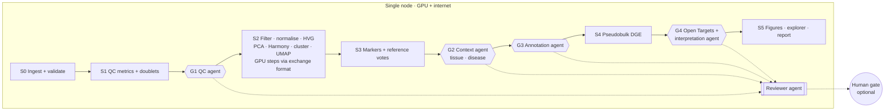

# singlecell: agentic Seurat pipeline — design spec

Status: **implemented** (as-built view in [`ARCHITECTURE.md`](ARCHITECTURE.md)) · Version 0.5 · 17 Oct 2026
Changes in 0.5: stages are run by the built-in `cellwarden` runner (Python, `state.json` checkpoints) instead of Nextflow; no hosted CI (tests run locally or on the HPC); stages S0–S2 are implemented (see `docs/stages-spec.md`).
Changes in 0.4: runs directly on the Iridis X L4 **login node** (the only node with internet), without a SLURM job; accepts any dataset format and size; pluggable LLM providers with Claude Haiku 4.5 as default and a hard £30 budget guard.
Changes in 0.3: everything runs on **one internet-connected node** (first target: an Iridis X L4 node). No node-to-node hand-offs. CPU ⇄ GPU switching within the node is kept.
Changes in 0.2: first target site is University of Southampton Iridis X (SLURM + Apptainer); portability to any HPC.
Scope: the design behind the implementation; all seven build steps (section 9) are implemented. The contracts are `exchange-spec.md`, `stages-spec.md` and `agents-spec.md`; the as-built overview is `ARCHITECTURE.md`.

## 1. Goals

1. Run the complete single-cell pipeline on **a single internet-connected node with an NVIDIA GPU** (first target: Iridis X L4), with Seurat as the backbone and GPU acceleration where it pays off.
2. Switch individual steps between **CPU (Seurat)** and **GPU (rapids-singlecell)** through a defined, validated **Seurat ⇄ AnnData exchange format**.
3. Make QC inclusion/exclusion decisions with a **QC agent** working inside preset policy limits.
4. **Infer tissue and disease context automatically** from markers and cell types (organism fixed: human).
5. **Annotate clusters automatically** from multiple evidence sources.
6. Run **config-driven pseudobulk DGE** (conditions, replicates, contrasts) and enrich up/down-regulated genes with **Open Targets**.
7. Every agent decision passes an **independent reviewer agent**, with optional **human review gates** at key stages.

### Design principle

**Rules decide, agents advise, reviewers check, humans approve, everything is logged.**
Agents operate inside limits set in config; hard limits are enforced in code, not by prompt. Anything outside policy becomes a review item, never a silent change.

## 2. Infrastructure: one node does everything

| Requirement | Why |
|---|---|
| One node with outbound internet | Agents call the Claude API; enrichment calls Open Targets; references download on first use |
| One NVIDIA GPU (CUDA 12) | GPU steps via rapids-singlecell. **Optional:** without a GPU every step runs on CPU |
| Apptainer, Singularity or Docker | One container image holds everything |

First target: **the Iridis X L4 login node** (24 GB GPU), the only node with internet access. The pipeline runs there directly, not as a SLURM job. The same design runs unchanged on any other single node that meets the table, for example a workstation, a cloud VM with an L4 (AWS g6), or a compute node with internet on another HPC.

What the single node simplifies:

- **No node-to-node hand-offs.** All stages, the exchange files and the gate bundles live in one run directory.
- **No offline reference staging.** References (CellTypist models, Seurat references, SingleR references, Ensembl annotation) download on first use into a checksummed `refs/` cache, so later runs and reruns are reproducible and don't re-download.
- **One container image** instead of two.

Unchanged principles:

- **Agents still never see raw counts.** They read small derived tables (per-cell QC metrics, marker tables, reference votes, DE tables). Only aggregated statistics and gene names go to the LLM provider and Open Targets.
- **The LLM API key is a secret.** It's read from an environment variable or a permission-restricted file in the user's home directory, never from config files or the repo, and it's never written to logs. On a shared login node this matters more: other users can see process lists, so the key is never passed as a command-line argument.

### 2.1 Running on a shared login node

Login nodes are shared by everyone on the cluster, and most HPC acceptable-use policies limit heavy or long-running work on them. Some clusters also run watchdogs that kill processes over a CPU, memory or time threshold. **Before production use, confirm with the Iridis team (hpc@soton.ac.uk) that a multi-hour GPU pipeline on the L4 login node is allowed, and whether any resource limits apply.**

Safeguards built in for login-node use:

| Safeguard | How |
|---|---|
| Resource caps | Thread, RAM and GPU-memory limits set in the site file and enforced at start-up (`setThreads()`, BLAS/OpenMP threads, RAPIDS memory pool size) |
| Polite scheduling | Runs under `nice`, so interactive users keep priority |
| Survives disconnects | Runs inside `tmux` or `screen` (`cellwarden run --detach`), so closing the SSH session doesn't stop it |
| Shares the GPU | Checks free GPU memory at start and before each GPU step; waits or falls back to CPU rather than failing if another user is on the GPU |
| Survives being killed | Checkpoint after every stage and every agent decision; `cellwarden resume` continues from the last one |

**Fallback if login-node compute isn't permitted:** set `execution: split`. Heavy stages are submitted as SLURM jobs to an offline GPU partition, while agents and Open Targets stay on the login node, with gate bundles on shared storage. This is a configuration switch, not a different pipeline.



## 3. Pipeline stages and gates

### 3.0 Inputs: any dataset

The organism is fixed to human. S0 accepts any of these, mixed across samples in one sample sheet:

| Format | Notes |
|---|---|
| 10x Genomics `.h5` or `matrix.mtx` folders (Cell Ranger, Cell Ranger multi) | Ensembl IDs taken from the features file |
| `.h5ad` (AnnData) | Raw counts read from `layers["counts"]` or `raw.X`; a matrix that looks normalised rather than raw is rejected with a clear message |
| Seurat objects (`.rds`, `.qs2`) | v4 objects upgraded to v5 assays |
| Loom, Parse Biosciences, BD Rhapsody, plain CSV/TSV count matrices | Via format adapters |

- **Gene IDs:** if a dataset has only gene symbols, they are mapped to Ensembl IDs with the bundled GENCODE annotation, and unmapped symbols are reported.
- **Size:** any. Counts are kept on disk with BPCells, and the memory plan (section 5.1) is chosen automatically from the cell count and the node's free GPU memory and RAM.

| Stage | Device | What happens | Gate after it |
|---|---|---|---|
| S0 Ingest | CPU | Read 10x/h5/h5ad into BPCells on-disk counts; validate the sample sheet against config | — |
| S1 QC metrics | CPU | Genes, UMIs, mito %, ribo %, haemoglobin %, doublet score (scDblFinder), quick pre-clustering for cluster-aware checks | **G1 QC** |
| S2 Core processing | CPU + **GPU** | Apply QC decisions; normalise and HVG in Seurat; scale + PCA, Harmony, neighbours, Leiden, UMAP on the GPU (or CPU) | — |
| S3 Evidence | CPU (+ GPU for CellTypist) | Cluster markers (presto); reference-mapping votes (CellTypist, Seurat reference mapping, SingleR); marker-set scores | **G2 Context**, then **G3 Annotation** |
| S4 DGE | CPU | Pseudobulk per sample × cell type; DESeq2 contrasts from config | **G4 DGE + Open Targets** |
| S5 Report | CPU | Figures, interactive explorer, final report including the full decision log | — |

### Gate mechanics

Each gate runs: **worker agent → reviewer agent → (optional) human**.

- The pipeline stops at a gate, writes a **review bundle** (HTML report, proposed decisions file, evidence, reviewer verdict) and exits cleanly. Nothing keeps running or holding the GPU while it waits for a human.
- After approval, the run resumes from the checkpoint. No completed stage is recomputed.
- Gate mode is set per gate in config:

| Mode | Behaviour |
|---|---|
| `auto` | Worker decides within policy; reviewer must approve; proceeds without a human |
| `review` | As `auto`, but always pauses for a human |
| `escalate` (default) | Pauses for a human only if the reviewer rejects, or any decision is flagged outside policy |

Recommended defaults: G1 `escalate`, G2 `review` (disease context drives interpretation), G3 `escalate`, G4 `review`.

## 4. Agents

All agents use an **LLM with tool use** through a provider adapter (section 4.8). The default is Claude Haiku 4.5, and the model can be set per role. Agents can only act through the tools listed; every tool validates its inputs against policy in code.

### 4.1 QC agent (G1)

**Input:** `qc_metrics.parquet` (one row per cell: sample, metrics, doublet score, pre-cluster id). This is small: about 100 bytes per cell, so 5M cells is about 0.5 GB.

**Policy (`qc_policy.yaml`):**

```yaml
hard_limits:            # never crossed, enforced in code
  min_genes: 200
  max_mito_pct: 25
adaptive:               # per-sample, median ± n MADs
  n_mads: 3
  metrics: [log_genes, log_umis, mito_pct]
protected_populations:  # never auto-removed as a group
  - name: Platelet
    markers: [PPBP, PF4, GNG11]
  - name: Erythrocyte
    markers: [HBB, HBA1]
review_triggers:
  max_cells_removed_per_sample_pct: 30
  max_cluster_removed_pct: 50     # a whole cluster vanishing → review, not delete
```

**Tools:**

| Tool | Purpose |
|---|---|
| `get_qc_summary(sample?)` | Distributions and per-sample stats |
| `simulate_filter(thresholds)` | Cells removed per sample and per pre-cluster, without applying anything |
| `check_protected(thresholds)` | Whether any protected population would be lost |
| `propose_decision(thresholds, rationale)` | Rejected in code if outside hard limits |
| `flag_for_review(cells or cluster, reason)` | Sends items to the human list |

**Output:** `qc_decisions.parquet` (cell_id, `keep` / `exclude` / `review`, reason codes such as `HIGH_MT`, `LOW_GENES`, `DOUBLET`, `PROTECTED_POP`) and `qc_report.html`.

### 4.2 Context agent (G2): tissue and disease

Organism is fixed to **human**. Tissue and disease are inferred.

**Evidence used:** cluster markers, reference-mapping votes, cell-type composition, signature scores (inflammation, interferon, proliferation, hypoxia), and optionally copy-number evidence (inferCNV) for malignancy.

**Outputs:**

- **Tissue:** e.g. `peripheral blood` with UBERON ID and confidence. Marker-based tissue inference is usually reliable.
- **Disease context:** a ranked list of candidate states (e.g. "healthy", "viral infection signature", "malignant epithelial cells present") with EFO IDs, resolved via Open Targets entity search. Disease inference from expression alone is **speculative**, so this gate defaults to `review`.
- **Reference choice:** which CellTypist model and Seurat reference to use for annotation, based on the inferred tissue.

Free-text sample metadata, if present, is offered as a hint and treated strictly as data, never as instructions.

### 4.3 Annotation agent (G3)

**Evidence per cluster, combined by weighted vote:**

1. Reference mapping: CellTypist, Seurat/Azimuth reference mapping, SingleR.
2. Marker-set scores (config gene sets, PanglaoDB, CellMarker).
3. The cluster's own top DE markers.

**Consensus first:** each cluster gets a label at broad and fine levels, a Cell Ontology ID (`CL:`), a confidence score, and every source's vote.

**The agent acts only on low-confidence or conflicting clusters.** It proposes a label with rationale, marked `agent-proposed`. It never overwrites a high-confidence consensus. Clusters with no defensible label become `Unassigned`.

**Output:** `annotation.csv` with cluster, label_broad, label_fine, cl_id, confidence, per-source votes, status (`consensus` / `agent` / `review`).

### 4.4 DGE interpretation agent (G4)

Runs after Open Targets enrichment (section 6). It writes the narrative summary per contrast: which up/down genes have drug, tractability or disease evidence. Every interpretation is labelled as a **hypothesis**, with the supporting Open Targets evidence cited by ID.

### 4.5 Reviewer agent

A separate agent with a separate system prompt and, where configured, a different model.

- **Sees:** the worker's inputs, the worker's proposed output, the policy, and the evidence. It does **not** see the worker's reasoning, to avoid anchoring on it.
- **Checks:** policy compliance, internal consistency (e.g. a label contradicted by its own top markers), evidence sufficiency, and anomalies (e.g. one sample losing far more cells than others).
- **Verdict:** `approve`, `request_changes` (one revision round back to the worker), or `escalate` (to a human).
- **Constraint:** the reviewer cannot edit decisions itself and cannot approve beyond policy.

### 4.6 Human review

- **Review bundle per gate:** an HTML report (plots, tables, worker rationale, reviewer verdict) and an editable decisions file.
- **To approve:** `cellwarden approve --stage qc`, or edit the decisions CSV and run `cellwarden approve --stage qc --from-file edited.csv`. Edits are validated against policy before acceptance.
- **Recorded:** who approved, when, and what changed relative to the agent proposal.
- **Later option:** a web review page with approve/reject buttons, built on the same bundle.

### 4.7 Audit and reproducibility

- `agent_log.jsonl` for every agent call: stage, role, model, prompt hash, input artifact checksums, tool calls, output, reviewer verdict, human decision, timestamps.
- **Replay mode** reuses logged decisions, so a re-run produces identical results without calling the API.
- Policies and configs are versioned; their hashes are stored in every output.

### 4.8 LLM providers and budget

**Provider adapter.** Agents talk to one internal interface. Each provider is a small adapter that translates tool definitions and tool calls, so a future user can switch model in config without changing agent code:

```yaml
llm:
  default:
    provider: anthropic                # anthropic | openai_compatible | bedrock | vertex
    model: claude-haiku-4-5
    api_key_env: ANTHROPIC_API_KEY     # name of the environment variable, never the key itself
  roles:                               # optional per-role overrides
    reviewer: { model: claude-haiku-4-5 }
  budget:
    currency: GBP
    total_limit: 30                    # hard stop across all runs
    per_run_limit: 5
    warn_at_pct: 80
```

- **`openai_compatible`** covers most other hosted models and local servers (for example vLLM or Ollama), so sites without a Claude account can still run the agents.
- **Capability check:** `cellwarden doctor` runs a short tool-use and structured-output test against the configured model, since agents depend on both.
- **Model choice:** Haiku 4.5 suits these well-structured tasks. A stronger model can be set for the context or reviewer role if a future budget allows.

**Budget guard.** A local cost ledger records token use and cost for every call, using the provider's published prices.

| Event | Behaviour |
|---|---|
| 80% of a limit used | Warning in the log and the gate report |
| A call would exceed the per-run or total limit | No call is made; the gate falls back to rules-only decisions and pauses for a human |
| Run ends | Cost summary in the run report |

**Expected cost with Haiku 4.5.** Published pricing is $1 per million input tokens and $5 per million output tokens; repeated prompt content read from cache costs $0.10 per million. The agents send summary tables, not cells, so token use depends on the number of clusters and DE genes rather than dataset size. My planning estimate is roughly **$1–3 per full run**, meaning the £30 limit covers on the order of 10–25 full runs. Prompt caching of the fixed system prompts and tool definitions keeps this down. Real costs will be read from the ledger after the first runs.

## 5. Seurat ⇄ AnnData exchange format (CPU/GPU switching)

Each step declares `device: cpu | gpu` in config. Crossing a device boundary uses this format.

| Seurat | AnnData (`.h5ad`; `.zarr` above ~5M cells) |
|---|---|
| `counts` layer | `layers["counts"]` (int, CSR, transposed to cells × genes) |
| `data` layer | `X` (log-normalised) |
| `scale.data` | not transferred; recomputed on the receiving side |
| `meta.data`, `Idents()` | `obs` (factors kept as categoricals) |
| feature metadata, HVGs | `var` incl. `highly_variable`, `gene_id` (Ensembl), `gene_symbol_original` |
| reductions: PCA, Harmony, UMAP | `obsm["X_pca"]`, `obsm["X_harmony"]`, `obsm["X_umap"]`; loadings `varm["PCs"]` |
| graphs: SNN, kNN | `obsp["connectivities"]`, `obsp["distances"]` |
| provenance | `uns["exchange"]`: schema version, stage, config hash, package versions, checksums |

**Modes:**

- **Full:** the whole object, used when a complete stage switches device.
- **Slim (default for GPU steps):** send only the HVG matrix plus `obs`; return only results (embeddings, graphs, clusters). Much less I/O.

**Round-trip rules:**

- Merge back **by cell barcode, never by position**.
- **Validate** identical cell and gene sets, an unchanged counts checksum, and preserved categorical levels.
- **Protect gene names:** Seurat rewrites `_` to `-` in feature names, so the original symbols are kept in `var` and restored on return.

**Libraries:** anndataR on the R side (no Python needed), BPCells for on-disk counts, anndata + rapids-singlecell on the GPU side.

**On a single node** the exchange files go to node-local scratch (fast disk) and are deleted after a successful merge, keeping only their checksums in the provenance record. The file format stays even though R and Python share the node: it makes every CPU⇄GPU crossing inspectable, testable and resumable.

### 5.1 Fitting the data on a 24 GB L4

The largest GPU object is the scaled variable-gene matrix: 2,000 genes × 4 bytes is about **8 KB per cell**. The planning estimates below are mine and will be checked against measured peak GPU memory on the first runs:

| Cells | Plan |
|---|---|
| Up to roughly 1M | Fits on one L4 with the slim exchange mode |
| Roughly 1–3M | RAPIDS managed memory, which spills from GPU to system RAM (slower but works); or more GPUs on the same node via rapids-singlecell's Dask mode |
| Beyond that | Seurat sketching (about 50k–100k representative cells on the GPU, then projected to all cells), or the CPU path with BPCells |

`cellwarden doctor` reports the GPU's total and currently free memory. The pipeline picks the plan from the cell count after QC and the memory free at that moment, which matters on a shared login node. The chosen plan is recorded in the run summary.

## 6. DGE and Open Targets

### 6.1 Sample sheet and DGE config

`samples.csv`:

```csv
sample_id,donor,condition,batch,path
S1,D1,control,B1,data/S1/filtered_feature_bc_matrix.h5
S2,D2,control,B1,data/S2/filtered_feature_bc_matrix.h5
S3,D3,control,B2,data/S3/filtered_feature_bc_matrix.h5
S4,D1,treated,B1,data/S4/filtered_feature_bc_matrix.h5
S5,D2,treated,B1,data/S5/filtered_feature_bc_matrix.h5
S6,D3,treated,B2,data/S6/filtered_feature_bc_matrix.h5
```

`config.yaml` (DGE section):

```yaml
dge:
  method: pseudobulk_deseq2
  unit: [sample_id, cell_type]          # pseudobulk grouping
  min_cells_per_pseudobulk: 10
  min_replicates_per_condition: 3        # validation fails below this
  design: "~ donor + condition"          # paired by donor; covariates from samples.csv
  contrasts:
    - name: treated_vs_control
      factor: condition
      numerator: treated
      denominator: control
      cell_types: all                    # or a list
  thresholds:
    padj: 0.05
    abs_log2fc: 0.5
  opentargets:
    enabled: true
    max_genes_per_direction: 200         # ranked by padj, then |log2FC|
```

**Validation before S4 runs:**

- Every contrast level exists in `samples.csv`.
- Replicates per condition ≥ `min_replicates_per_condition`.
- The design matrix is full rank.
- Cell types with too few pseudobulk samples are skipped with a logged reason.

### 6.2 Open Targets enrichment

- **Endpoint:** the Open Targets Platform GraphQL API, `https://api.platform.opentargets.org/api/v4/graphql`.
- **Gene IDs:** Ensembl IDs come straight from the 10x feature files, so symbol mapping isn't needed.
- **Fetch strategy:** batched queries with a local cache, following Open Targets' guidance not to query one gene at a time. Very large lists switch to the Open Targets downloadable datasets.
- **Retrieved per gene:** function, tractability, known drugs and trial phase, top associated diseases, association score for the disease context from G2 (if set), genetic constraint, and safety liabilities. Exact field names will be confirmed against the live GraphQL schema during implementation.
- **Direction comes from our data.** Open Targets has no notion of up or down regulation. The report joins our log2FC/padj with Open Targets evidence.
- **Exploration:** the official Open Targets MCP server (experimental) can be added later for interactive questions. The pipeline itself uses direct GraphQL calls for determinism.

**Output:** `dge/<contrast>/<cell_type>_opentargets.csv`, an Excel workbook with one sheet per contrast, and an HTML report.

## 7. Orchestration, environment and portability

First target: **the Iridis X L4 login node, run directly** (Apptainer, no scheduler). Requirement: any single node with internet (GPU optional) on any HPC, workstation or cloud VM can run the pipeline after writing **one small site file**, without touching pipeline code.

### 7.1 Execution modes

| `execution` | Where it runs | Use when |
|---|---|---|
| `direct` (Iridis X default) | Directly on the current node, inside `tmux`, with resource caps (section 2.1) | The node with internet is a login node or workstation |
| `slurm` (also `pbs`, `lsf`, `sge`) | One scheduler job on a compute node that has internet | A site's compute nodes have internet |
| `split` | Heavy stages as offline scheduler jobs; agents and Open Targets on the internet node | A site doesn't allow compute on its internet node |

In every mode the built-in `cellwarden` runner executes the stages one after another and records each in `state.json` with a fingerprint of its inputs and settings, so a rerun skips finished stages. At a gate the run exits cleanly, and `cellwarden approve` resumes it.

### 7.2 Site profile

A new site is one small YAML file, `conf/sites/<site>.yaml`, that supplies defaults for the `execution`, `resources` and `container` sections of `config.yaml`. Until `cellwarden init-site` exists (build step 7), the same keys are set directly in `config.yaml`, as in `config/examples/config.yaml`. A sketch for Iridis X (limits to be agreed with the Iridis team):

```yaml
site: iridisx
execution: direct            # direct | slurm | pbs | lsf | sge | split
resources:
  threads: 8                 # cap for a shared login node
  max_memory_gb: 64
  gpu_mem_cap_gb: 20         # leave headroom on the shared L4
  nice: 10
scratch: /scratch/$USER/cellwarden
container:
  runtime: apptainer         # apptainer | singularity | docker | none
  options: ["--nv"]
```

The same pipeline runs at any site by pointing `config.yaml` at a different site file.

### 7.3 Making it easy for any user

The `cellwarden` command is the only thing users run. It drives the stages itself and submits to the scheduler when the site needs it:

| Command | What it does |
|---|---|
| `cellwarden init-site` | Detects the scheduler, partitions, GPU type and memory, container runtime and internet access, then drafts the site file for the user to confirm |
| `cellwarden doctor` | Preflight check: GPU, driver vs CUDA version and free GPU memory, container runtime, internet to the LLM provider and Open Targets, API key present, an LLM tool-use test, remaining budget, write access to scratch |
| `cellwarden run --config config.yaml [--detach]` | Starts the run in the site's execution mode; `--detach` runs it inside `tmux` |
| `cellwarden resume` | Continues from the last checkpoint after a disconnect, kill or gate |
| `cellwarden status` | Current stage, gate status, LLM spend so far, last log lines |
| `cellwarden approve --stage <gate>` | Human approval; submits the resume job |

### 7.4 Degrading gracefully

| If the node has... | The pipeline... |
|---|---|
| No GPU | Runs every step with `device: cpu` (pure Seurat): slower, same stages and outputs |
| A smaller or larger GPU | Picks the memory plan from section 5.1 based on detected GPU memory |
| Several GPUs | Can use rapids-singlecell's Dask mode for very large datasets |
| Singularity instead of Apptainer | Same image; the site file names the runtime |
| Docker only | `container.runtime: docker`, same image |

### 7.5 Container

- **One image**, published to a public registry (GHCR) and pulled as a `.sif`. It contains R 4.6, Seurat 5.6, BPCells, presto, DESeq2, anndataR, reticulate, rapids-singlecell (CUDA 12), CellTypist, SingleR, the LLM provider adapters (Anthropic SDK and an OpenAI-compatible client) and the Open Targets client.
- **Versioned tags and digests** pinned in each pipeline release, so every site runs identical software.
- **Built on a CUDA 12 base**, run with `--nv`. `cellwarden doctor` checks that the node's driver supports it.

### 7.6 Storage

- **Run directory:** scratch, for stage outputs, `state.json`, exchange files and gate bundles.
- **Results:** project storage.
- **`refs/` cache:** downloaded once and shared across runs.

All three locations are set in the site file.

### 7.7 Testing

- PBMC 3k as an end-to-end smoke test, runnable on any site in minutes.
- **Benchmarks during development are limited to 2k and 5k cells** (`tests/benchmark/run_bench.sh`), CPU path and GPU path. A 50k-cell subset is run in both modes and compared (ARI) on the HPC before any full run, never on development machines.
- No hosted CI (we decided not to use GitHub Actions). The unit tests and the end-to-end stage test run locally or on the HPC; `tests/README.md` lists the commands.

## 8. Repository layout (proposed)

```
config/            config.yaml, qc_policy.yaml, samples.csv (examples)
R/                 Seurat stages, exchange format (R side), plotting theme
python/            GPU steps, exchange format (Python side)
agents/            QC, context, annotation, interpretation, reviewer; tool definitions; prompts
opentargets/       GraphQL client, queries, cache
cellwarden/ (python/)  runner, config, resources, QC rules engine, gate logic
conf/sites/        one site file per HPC (iridisx.yaml first), plus workstation and docker examples
containers/        recipe for the single image
tests/             exchange round-trip tests, policy tests, PBMC smoke test
docs/DESIGN.md     this document
```

## 9. Build order

1. **Exchange format** with round-trip tests. Everything else depends on it.
2. **Stages S0–S2** with the CPU/GPU switch, validated on the synthetic fixture and benchmarked at 2k and 5k cells.
3. **QC agent + reviewer + gate mechanics**, the template for all later gates.
4. **Evidence (S3), context agent, annotation agent.**
5. **DGE (S4), Open Targets, interpretation agent.**
6. **Final report, explorer, local test suite.**
7. **Portability:** `cellwarden init-site` and `doctor`, plus a second site profile tested to prove the site-file approach.

## 10. Open questions

Resolved:
- Runs directly on the Iridis X L4 login node, the only node with internet.
- Any dataset format and size.
- LLM: Claude Haiku 4.5 by default, a £30 total budget, and any provider selectable by future users.

Still open:
1. **Login-node policy:** written confirmation from the Iridis team that a multi-hour GPU pipeline on the L4 login node is permitted, and any CPU, memory, GPU or time limits to configure. If not permitted, the `split` mode is used.
2. **GPU on the login node:** is the L4 dedicated to this node's users, and how many GPUs does it have? This sets the default `gpu_mem_cap`.
3. **Storage:** which scratch and project paths to use for runs, results and the shared `refs/` cache.

## 11. Risks

| Risk | Mitigation |
|---|---|
| Agent makes a wrong QC or annotation call | Policy bounds in code, independent reviewer, human gates, full audit log |
| Disease context inferred incorrectly | `review` gate by default; candidates shown with evidence and confidence, never applied silently |
| GPU and CPU paths give different clusters | Aligned parameters, subset ARI check before full runs |
| A run fails mid-way (missing reference, wall-time limit, network blip) | Startup `doctor` check; resume from the last completed stage; API and Open Targets calls retried with backoff and cached |
| Dataset too large for a 24 GB GPU | Memory plan chosen automatically (section 5.1); CPU path always available |
| Node or partition access changes | Site file is the only place node details live; `init-site` regenerates it |
| Login-node compute not permitted, or processes killed by a watchdog | Confirm policy first; resource caps, `nice` and checkpoints; `split` mode as fallback |
| LLM spend exceeds the £30 limit | Ledger-based hard stop before any call that would exceed it; rules-only fallback with a human gate |
| A future user's chosen LLM handles tools poorly | `cellwarden doctor` tool-use test; rules and reviewer still enforce policy in code |
| Data leaves the cluster | Agents receive only aggregated tables and gene names; no counts or sample metadata beyond IDs |
| Open Targets schema changes | Queries pinned per release; cached responses; schema check in the local test suite |
