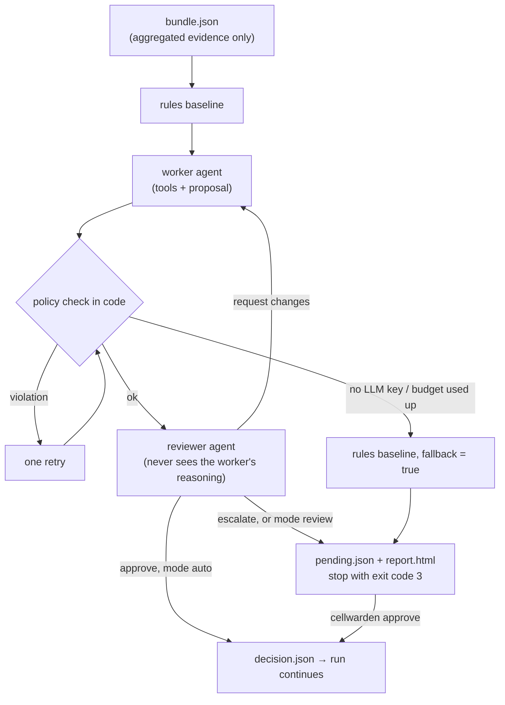

# cellwarden: the pipeline, end to end

One page that describes the whole pipeline: what goes in, every stage and review gate in
order, what comes out, how to configure and run it, and where things stand. The detailed
contracts are in [`stages-spec.md`](stages-spec.md) (S0–S2, runner), [`agents-spec.md`](agents-spec.md)
(gates, S3–S5) and [`exchange-spec.md`](exchange-spec.md) (Seurat ⇄ AnnData); the as-built
architecture is [`ARCHITECTURE.md`](ARCHITECTURE.md); installation is [`INSTALL.md`](INSTALL.md).

> **Rules decide, agents advise, reviewers check, humans approve, everything is logged.**

---

## 1. What CellWarden is

CellWarden takes single-cell RNA-seq count matrices from one or more samples and produces a
quality-controlled, clustered, annotated and interpreted dataset with a self-contained HTML
report, in one command.

- **Seurat (R) is the backbone.** Every stage's main object is a Seurat object.
- **A Rust engine, `scfast`, does the heavy numerical work** (preprocessing, doublets, PCA,
  neighbours, Leiden, UMAP) in process, on CPU or NVIDIA GPU. It replaces the equivalent Seurat
  and Scanpy steps at 30–80× their speed while matching Seurat's results.
- **LLM agents advise at four review gates** (QC, biological context, annotation, interpretation).
  Rules in code bound what an agent may change, a separate reviewer agent checks every proposal,
  and a human can approve or override at any gate. Without an LLM key the gates run on rules alone.
- **Every decision is recorded:** per-cell QC reason codes, gate bundles/proposals/reviews/decisions,
  an LLM call log with hashes for replay, config fingerprints per stage.

## 2. The flow

```mermaid
flowchart LR
  S0["S0 ingest<br/>(R)"] --> S1a["S1a QC metrics<br/>(R)"] --> S1b["S1b doublets<br/>(Python)"] --> S1c["S1c QC rules<br/>(Python)"]
  S1c --> G1{{"G1 QC gate"}} --> S2["S2 core processing<br/>(R, CPU or GPU)"]
  S2 --> S3["S3 evidence + annotation<br/>(R + Python)"] --> G2{{"G2 context gate"}} --> G3{{"G3 annotation gate"}}
  G3 --> S4["S4 DGE (FindMarkers or pseudobulk)<br/>+ Open Targets"] --> G4{{"G4 interpretation gate"}} --> S5["S5 report<br/>+ explorer"]
```



Stages (S) transform data; gates (G) are decision points where the pipeline may stop for a person.

| Order | Step | Language | Main inputs | Main outputs |
|---|---|---|---|---|
| 1 | **S0** ingest | R | `samples.csv` + count files | `S0/object.rds`, `S0/ingest_report.json` |
| 2 | **S1a** QC metrics | R | S0 object | `S1/qc_metrics.tsv.gz` |
| 3 | **S1b** doublets | Python | QC metrics | doublet score, call and pre-cluster added to `S1/qc_metrics.tsv.gz` |
| 4 | **S1c** QC rules | Python | QC metrics, `qc_policy.yaml` | `S1/qc_decisions.tsv.gz`, `S1/qc_summary.json` |
| 5 | **G1** QC gate | Python | S1 outputs, policy | `gates/G1/*`; may rewrite `S1/qc_decisions.tsv.gz` |
| 6 | **S2** core processing | R (+ GPU) | S0 object, QC decisions | `S2/object.rds`, `S2/summary.json` |
| 7 | **S3** evidence + annotation | R + Python | S2 object | `S3/markers.tsv.gz`, `S3/signatures.tsv.gz`, `S3/annotation_consensus.tsv`, `S3/evidence_bundle.json` |
| 8 | **G2** context gate | Python | S3 evidence bundle | `gates/G2/*` (tissue and disease context) |
| 9 | **G3** annotation gate | Python | S3 bundle, consensus | `gates/G3/*`, `S3/annotation.tsv` (final labels) |
| 10 | **S4** DGE + Open Targets | R + Python | S2 object, final labels, `dge:` config | `S4/dge_summary.json`, `S4/opentargets_summary.json`, DGE tables |
| 11 | **G4** interpretation gate | Python | S4 summaries | `gates/G4/*` (labelled hypotheses) |
| 12 | **S5** report | R + Python | everything above | `S5/report.html`, `S5/explorer.html`, `S5/umap.tsv.gz` |

---

## 3. Inputs

**Quickest: give the data files on the command line.** The format of each is detected, every
file or folder becomes one sample, and no config file is needed:

```bash
cellwarden run donorA.h5 donorB.rds donorC.h5ad                 # files of any supported format
cellwarden run /data/cellranger_runs/                             # a folder: every sample in it (Cell Ranger outs/ too)
cellwarden run samples.csv                                        # a samples sheet (3.1)
cellwarden run a.h5 b.h5 --meta condition=control --out results/  # add a metadata column, choose the output folder
cellwarden run a.h5 b.h5 --config config.yaml                     # the files, with your other settings
```

- Sample IDs come from the file names (or the folder for Cell Ranger's generic names such as
  `filtered_feature_bc_matrix.h5`); clashes get `_2`, `_3`.
- Results go to `--out`, or `./cellwarden_<first sample or --name>_<date>`; a non-empty folder that is
  not an earlier CellWarden run is never overwritten. The same command again resumes.
- The run writes the config it used to `<out>/config/input_config.yaml`; edit it and run
  `cellwarden run --config <out>/config/input_config.yaml` to change settings.
- The built-in QC policy (3.2) applies unless your config names another.

For full control you prepare three files next to your data (templates in [`config/examples/`](../config/examples)).

### 3.1 `samples.csv`: one row per sample

```csv
sample_id,path,format,donor,condition,batch
S1,data/S1/filtered_feature_bc_matrix.h5,,D1,control,B1
S2,data/S2/filtered_feature_bc_matrix,10x_mtx,D2,control,B1
S3,data/S3/S3_counts.h5ad,h5ad,D3,treated,B2
S4,data/S4/S4_seurat.rds,seurat,D4,treated,B2
```

- `sample_id` and `path` are required; paths are relative to the sheet.
- `format` is optional (auto-detected): `10x_h5`, `10x_mtx`, `h5ad`, `seurat` (`.rds`/`.qs2`),
  `loom`, `table` (csv/tsv).
- Any other column (`donor`, `condition`, `batch`, …) is sample metadata: it is copied to every
  cell, used for integration (`integration.batch_key`) and DGE (`dge.sample_col`,
  `dge.condition_col`), and shown to the agents as data (never as instructions).

### 3.2 `qc_policy.yaml`: the QC rules

```yaml
hard_limits:                  # never crossed, by rules or agents
  min_genes: 200
  max_mito_pct: 25
  min_umis: 400
adaptive:                     # per sample, median ± n_mads × MAD on the log scale
  n_mads: 3
  metrics: [log_genes, log_umis, mito_pct]
  min_cells_for_mad: 100
doublets:
  exclude_called: true
protected_populations:        # small/low-RNA cell types that adaptive bounds would wipe out
  - {name: Platelet,    markers: [PPBP, PF4, GNG11], min_fraction: 0.01}
  - {name: Erythrocyte, markers: [HBB, HBA1, HBA2],  min_fraction: 0.05}
review_triggers:              # large losses go to review instead of being applied
  max_cells_removed_per_sample_pct: 30
  max_cluster_removed_pct: 50
```

### 3.3 `config.yaml`: everything else

The full key list with defaults is in section 8. The minimum is:

```yaml
project: my_study
run_dir: /scratch/$USER/cellwarden/my_study
samples: samples.csv
qc_policy: qc_policy.yaml
site: iridisx               # optional: conf/sites/<name>.yaml or a path
```

Every setting is validated before anything runs, and all problems are reported at once.

---

## 4. The stages in detail

### S0: Ingest (R, `R/stages/s0_ingest.R`)

- Reads every sample in `samples.csv`, detecting the format from the file.
- Merges samples into **one Seurat object** with a **gene union** (genes missing in a sample
  are zero there) and sample-prefixed barcodes.
- Refuses non-integer counts (normalised data passed off as counts) and checks the organism
  (human gene symbols).
- Copies the sample-sheet columns to each cell's metadata.
- **Count tables** may be genes x cells or cells x genes: the orientation is detected from which
  side holds gene symbols or Ensembl IDs, and recorded in the report.
- **Raw 10x matrices** (`raw_feature_bc_matrix`, or > 100,000 barcodes with a median below 10 UMIs)
  are reduced to cell-containing barcodes at the barcode-rank knee before merging
  (`ingest.empty_drops: auto | on | off`, default `auto`); kept, dropped and the UMI threshold are
  recorded per sample.
- **Writes:** `S0/object.rds` (or `.qs2` with `object_format: qs2`), `S0/ingest_report.json`
  (cells and genes per sample, detected formats, warnings).

### S1a: QC metrics (R, `R/stages/s1a_metrics.R`)

- Per cell: genes detected, UMIs, % mitochondrial, % ribosomal, % haemoglobin, and a
  marker-signal score for each protected population in the policy.
- On the Rust path (`scfastR` installed, CPU plan) it also computes doublet scores, doublet
  calls and pre-clusters in process (`R/stages/doublets_scfast.R`).
- **Writes:** `S1/qc_metrics.tsv.gz` (one row per cell); a transient counts file for S1b on
  the Seurat/GPU path.

### S1b: Doublets (Python, `cellwarden/stages/s1b_doublets.py`)

- `doublets.method`: `scrublet` (default, per sample; on the GPU via rapids-singlecell when
  available), `scdblfinder`, or `none`.
- Adds a doublet score, a doublet call and a coarse **pre-cluster** per cell (used by the
  cluster-loss review trigger).
- On the Rust path S1a has already done this and S1b passes the table through.

### S1c: QC rules engine (Python, `cellwarden/stages/s1c_qc.py`, `cellwarden/qc.py`)

Every cell ends **keep**, **exclude** or **review**, with reason codes, by applying in order:

1. **Hard limits** → exclude (`LOW_GENES`, `LOW_UMIS`, `HIGH_MT`).
2. **Adaptive bounds** per sample → exclude (`ADAPT_LOW_GENES`, `ADAPT_HIGH_UMIS`, …).
3. **Doublet calls** → exclude (`DOUBLET`).
4. **Protected populations:** a cell excluded *only* by adaptive bounds that carries enough
   marker signal → review (`PROTECTED_POP:Platelet`).
5. **Review triggers:** if a sample loses more than 30 % of cells, or a pre-cluster loses more than
   50 %, those adaptive exclusions become review (`SAMPLE_LOSS`, `CLUSTER_LOSS`).
6. Everything else → keep.

`qc.review_action` (`keep` default, or `exclude`) decides what S2 does with cells still in review.
**Writes:** `S1/qc_decisions.tsv.gz` (decision + reason codes + policy hash per cell),
`S1/qc_summary.json`.

### G1: QC gate (Python, `cellwarden/gates/g1_qc.py`)

- The QC agent sees per-sample and per-cluster summaries (never per-cell rows) and may propose
  **tighter** thresholds, only inside the policy's hard limits.
- Accepted thresholds are re-applied **by the same rules engine**; the original S1c decisions
  are kept as the baseline.
- Default mode `auto`: continues on its own when the reviewer approves; stops for a human when
  the reviewer escalates.

### S2: Core processing (R, `R/stages/s2_core.R`)

Drops excluded cells, then:

1. **Normalise:** `normalization: lognorm` (default, Seurat LogNormalize) or `sct` (SCTransform, CPU only).
2. **Highly variable genes:** `n_hvg` (default 2,000, Seurat vst).
3. **Scale + PCA:** `pcs: auto` or a number (randomised SVD with implicit scaling on the scfast path).
4. **Integration (batch correction):** `integration.method: none` (default) or `harmony` on
   `integration.batch_key` (any sample-sheet column; `cellwarden run ... --integrate sample_id`).
   Harmony runs in **scfast's Rust implementation** wherever scfastR provides it: the harmony 2.x
   algorithm and defaults, with the same batch mixing and neighbour structure as R harmony (kNN
   overlap 0.97–0.98, the same as R harmony against itself with another seed) at a fraction of the
   time (200k cells × 30 PCs × 10 batches: 0.44 s vs 24 s for R harmony and 0.73 s for harmonypy,
   32 cores; 1M cells: 1.5 s). `integration.engine: r` forces R harmony; parameters under
   `integration.harmony` (`theta`, `lambda`, `sigma`, `nclust`, `max_iter`). On the GPU exchange
   path Harmony is rapids-singlecell's.
5. **Neighbours:** kNN with `n_neighbors` (default 20) and Seurat's shared-nearest-neighbour graph.
6. **Clustering:** Leiden at `clustering.resolution` (default 0.5).
7. **UMAP.**

**Which code runs it** is decided per run from `engine`, `engine_gpu`, `device` and the GPU's
free memory, and recorded as the `path` in `S2/summary.json`:

| Plan | Chosen with the defaults (`engine: auto`, `engine_gpu: auto`) | `path` |
|---|---|---|
| CPU, `scfastR` installed | Rust scfast, in process | `cpu_scfast` |
| CPU, no `scfastR` | Seurat | `cpu_seurat` |
| GPU fits, `scfastR` built with CUDA and a device visible | Rust scfast on CUDA, in process | `gpu_scfast` |
| GPU fits, otherwise | Seurat + rapids-singlecell through the exchange file | `gpu_exchange` |

On `gpu_exchange` the R stage writes a slim exchange `.h5ad`, `gpu_core` (Python) runs
PCA → Harmony → neighbours → Leiden → UMAP on the GPU, and the results are merged back **by
barcode**, refused if the counts checksum (SHA-256, identical in R and Python) does not match.

**Writes:** `S2/object.rds` (clusters, PCA, UMAP), `S2/summary.json` (path, device, memory
plan and why, timings, cluster counts).

### S3: Evidence and consensus annotation (R + Python, `cellwarden/stages/s3.py`, `R/stages/s3_evidence.R`)

- **Markers** per cluster (presto Wilcoxon) → `S3/markers.tsv.gz`.
- **Signature scores** for lineage gene sets (`R/stages/data/signatures.yaml`, or your own via
  `signatures:`) → `S3/signatures.tsv.gz`.
- **CellTypist** with `annotation.celltypist_model` (default `Immune_All_Low.pkl`; the container
  ships it; skipped with a note when unavailable).
- **Consensus:** a weighted vote of signatures, CellTypist and markers against **72 human cell
  types with Cell Ontology IDs**. Below `annotation.min_confidence` (0.6) a cluster is
  `low_confidence`; disagreeing sources mark it `conflict`.
- **Writes:** `S3/annotation_consensus.tsv`, `S3/cluster_summary.json`,
  `S3/evidence_bundle.json` (the aggregated evidence the agents see).

### G2: Context gate (Python, `cellwarden/gates/g2_context.py`)

The context agent infers the likely **tissue** (UBERON ID) and **disease** candidates (EFO IDs,
resolved through Open Targets) from the evidence; the organism is fixed to human. Because this is
speculative, the default mode is `review`: a person confirms it.

### G3: Annotation gate (Python, `cellwarden/gates/g3_annotation.py`)

The annotation agent may relabel **only** clusters the consensus marked `low_confidence` or
`conflict`, and only with labels from the cell-type table. Output: the final labels in
`S3/annotation.tsv`. Default mode `auto`.

### S4: Differential expression (FindMarkers or pseudobulk) + Open Targets (R + Python, `cellwarden/stages/s4.py`, `R/stages/s4_dge.R`)

- **FindMarkers (default, `dge.method: findmarkers`):** Seurat `FindMarkers` between two sets
  of cells with `dge.test` (MAST by default; wilcox, wilcox_limma, LR, t, bimod, negbinom,
  poisson, DESeq2), genes prefiltered by `min_pct` (0.1) and `logfc_threshold` (0.25); groups run
  in parallel (`resources.threads`). Without MAST installed, wilcox is used with a note.
- **Contrasts** name any cell metadata column and the values on each side, e.g.
  `{name: disease_vs_control, column: condition, numerator: disease, denominator: control}`,
  `{name: F_vs_M, column: sex, numerator: F, denominator: M}`,
  `{name: B_vs_rest, column: cell_type_broad, numerator: B cell, denominator: rest, within: none}`.
  `within` (default `group_by`) tests each cell type separately; covariates become MAST/LR
  `latent.vars`. With no contrasts and `markers: auto`, the markers of each `group_by` group
  against the other cells are found (contrast `markers`).
- **Pseudobulk (`dge.method: pseudobulk`, or `deseq2` / `limma_voom`):** counts summed per sample
  × group, keeping units with at least `min_cells_per_sample` (20) cells and `min_replicates` (2)
  samples per side; DESeq2 (`pseudobulk_method: deseq2`) or limma-voom. The contrast column must
  have one value per sample.
- Significance at `padj` 0.05 and `|log2FC|` ≥ `lfc` 0.5 (FindMarkers: Seurat's Bonferroni
  `p_val_adj`); FindMarkers tables also carry `pct_1` / `pct_2`.
- **Open Targets:** the top `opentargets.max_genes_per_direction` (50) up and down genes are
  annotated with associated diseases, known drugs and tractability (GraphQL API, cached in
  `refs/opentargets`, `offline: true` for no network).
- **Writes:** `S4/dge/*.tsv.gz`, `S4/dge_summary.json`, `S4/opentargets_summary.json`.

### G4: Interpretation gate (Python, `cellwarden/gates/g4_interpretation.py`)

The interpretation agent writes short, **labelled hypotheses** about the DGE results. Every
statement must cite Open Targets evidence IDs that exist in `opentargets_summary.json` and genes in
the direction our own DGE found; anything else is rejected in code. Default mode `review`.

### S5: Report and explorer (R + Python, `cellwarden/stages/s5_report.py`, `R/stages/s5_export.R`)

- `S5/report.html`: one self-contained page (no CDN): ingest, QC (counts, reasons, per sample),
  clustering and UMAP, annotation with evidence, every gate decision, DGE and interpretation.
- `S5/explorer.html`: interactive UMAP, colour by cluster, cell type, sample or gene
  (subsampled above `report.explorer_max_cells`, 100,000).
- `S5/umap.tsv.gz`, `S5/expr_subset.tsv.gz`: the embedding and an expression subset for reuse.

---

## 5. The review gates

Every gate follows the same protocol:



| Mode | Behaviour | Default for |
|---|---|---|
| `auto` | continues when the reviewer approves; stops on escalation | G1, G3 |
| `review` | always stops for a person after the agents | G2, G4 |
| `escalate` | always a person, agents only prepare the report | (set per gate in `gates:`) |

Each gate writes `gates/Gx/bundle.json`, `proposal.json`, `review.json`, `decision.json` and
`report.html` (plus `pending.json` while waiting). A stopped run waits for:

```bash
cellwarden approve --run-dir <run_dir> --stage context-review --by <your name>   # or --from-file decision.json
cellwarden resume  --run-dir <run_dir>
```

**LLM providers** (`python/cellwarden/llm/`): set an API key and the agents use it, no config needed.

| Key set | Provider | Default model |
|---|---|---|
| `ANTHROPIC_API_KEY` | `anthropic` (Claude) | `claude-haiku-4-5` |
| `OPENAI_API_KEY` | `openai` | `gpt-4.1-mini` |
| `NVIDIA_API_KEY` | `nvidia` (NIM, build.nvidia.com) | `nvidia/nemotron-3-ultra-550b-a55b` |

With several keys set, Claude is used first, then OpenAI, then NVIDIA. Choose explicitly with
`cellwarden run ... --llm nvidia [--llm-model <model>]` or `llm.default.provider` in the config;
`--llm none` turns the agents off. Any other OpenAI-style server (vLLM, Ollama, a local NIM) works
as `provider: openai_compatible` with a `base_url`. Roles can use different providers
(`llm.roles.reviewer: {provider: openai}`). The choice is recorded as `llm_choice` in
`config.resolved.yaml` and shown by `cellwarden doctor`; with no key the gates run on rules.
`max_tokens` per role caps each agent's answer (defaults: 2048 for workers, 1024 for the reviewer;
raise it for a model that reasons before answering). `extra_body` adds fields to each request on
OpenAI-style endpoints; NVIDIA Nemotron models get `chat_template_kwargs: {enable_thinking: false}`
by default, so they answer directly instead of spending the budget on reasoning text.

**Budget:** A
ledger prices every call and refuses any call that would cross the per-run limit (£5) or the
total (£30); the gate then falls back to rules and waits for a person. `llm/agent_log.jsonl`
records every call with prompt hashes; `replay: true` reproduces a run with no API calls. API
keys are read from an environment variable named in the config and never written to disk.

**What leaves the machine:** only aggregated tables (per-cluster markers, signature scores,
composition, DGE summaries, sample-sheet metadata values) go to the LLM; gene symbols go to Open
Targets. No counts, per-cell rows or barcodes.

---

## 6. Running it

```bash
cellwarden doctor  --config config.yaml                 # preflight: packages, GPU, LLM key, budget, Open Targets
cellwarden run     --config config.yaml --detach        # run in tmux; survives a dropped SSH session
cellwarden status  --run-dir <run_dir>                  # stage states, timings, peak memory
cellwarden dashboard --run-dir <run_dir> --watch 30     # live dashboard.html
cellwarden approve --run-dir <run_dir> --stage context-review --by me
cellwarden resume  --run-dir <run_dir>                  # continue after a gate, disconnect or kill
cellwarden init-site --write conf/sites/mysite.yaml     # draft a site file for a new machine
```

Useful options: `cellwarden run --until S2` (stop after a stage), `--no-gates` (record gates as
skipped), `--execution slurm` (submit as one job), `--run-dir` (override the config), `--llm` / `--llm-model`
(agents' provider and model), `--out` / `--name` / `--meta` (runs from data files, section 3).

**The runner** (`python/cellwarden/runner.py`) runs each stage as its own process under `nice`, with
thread, memory and GPU-memory caps passed as environment variables. `state.json` stores each
stage's status, timings, peak memory and a **fingerprint** of the config keys and input files it
uses: running again skips finished stages, and changing a setting reruns only the stages that
depend on it. `dashboard.html` is rewritten after every state change.

**Execution modes** (`execution:`): `direct` (this machine), `slurm` / `pbs` / `lsf` / `sge`
(one batch job from `conf/templates/`), `split` (heavy stages as an offline job, gates and Open
Targets on an internet-connected node).

**Containers:** with `container.image` set (in the site file), every stage runs inside the
CellWarden image, so the host needs only Python and `cellwarden`. On a cluster without FUSE (such as Iridis X, [docs/sites/iridis.md](sites/iridis.md)):

```bash
module load apptainer/1.4.0
export APPTAINER_TMPDIR=/tmp/$USER-apptainer
apptainer exec --unsquash --nv /path/to/cellwarden.sif cellwarden run --config config.yaml
```

---

## 7. The run directory

```
<run_dir>/
  config/            config.resolved.yaml, samples.csv, qc_policy.yaml (copies used by the run)
  state.json         stage status, timings, peak memory, fingerprints
  dashboard.html     live overview of the run
  logs/              one log per stage, runner.log
  S0/                object.rds, ingest_report.json
  S1/                qc_metrics.tsv.gz, qc_decisions.tsv.gz, qc_summary.json
  gates/G1..G4/      bundle.json, proposal.json, review.json, decision.json, report.html
  S2/                object.rds, summary.json
  S3/                markers.tsv.gz, signatures.tsv.gz, annotation_consensus.tsv, annotation.tsv,
                     cluster_summary.json, evidence_bundle.json
  S4/                dge/*.tsv.gz, dge_summary.json, opentargets_summary.json
  S5/                report.html, explorer.html, umap.tsv.gz, expr_subset.tsv.gz
  llm/               agent_log.jsonl (every LLM call)
```

---

## 8. Configuration reference (defaults)

| Key | Default | Options / meaning |
|---|---|---|
| `project` | `cellwarden` | name shown in the report |
| `run_dir` | — | where every output goes (required with `--config`; `--out` for data-file runs) |
| `ingest.empty_drops` | `auto` | empty-droplet filtering of raw 10x matrices: `auto`, `on`, `off` |
| `seed` | `42` | all random steps |
| `object_format` | `rds` | `rds`, `qs2` (faster for large objects) |
| `resources.threads` / `max_memory_gb` / `gpu_mem_cap_gb` / `nice` | 8 / 64 / 20 / 10 | caps for every stage |
| `doublets.method` | `scrublet` | `scrublet`, `scdblfinder`, `none` |
| `qc.review_action` | `keep` | what S2 does with cells left in review: `keep`, `exclude` |
| `normalization` | `lognorm` | `lognorm`, `sct` (CPU only) |
| `n_hvg` | `2000` | highly variable genes |
| `engine` | `auto` | `auto`, `scfast` (Rust), `seurat` |
| `engine_gpu` | `auto` | `auto`, `scfast` (Rust CUDA), `rapids` (exchange) |
| `device` | `auto` | `auto` (GPU if it fits), `cpu`, `gpu` |
| `integration.method` / `batch_key` | `none` / `sample_id` | `none`, `harmony`; `--integrate COLUMN` on the command line |
| `integration.engine` | `auto` | `auto` (scfast Rust Harmony when available), `scfast`, `r` |
| `integration.harmony.*` | `theta: 2, lambda: null, sigma: 0.1, nclust: null, max_iter: 10` | harmony 2.x parameters (`lambda: null` = automatic) |
| `pcs` | `auto` | number of PCs, or auto |
| `n_neighbors` | `20` | kNN size |
| `clustering.resolution` | `0.5` | Leiden resolution |
| `annotation.celltypist` / `celltypist_model` / `min_confidence` | `auto` / `Immune_All_Low.pkl` / `0.6` | CellTypist on/off, model, consensus threshold |
| `signatures` | — | path to your own signature YAML |
| `dge.*` | `method: findmarkers`, `test: MAST`, `pseudobulk_method: deseq2`, `markers: auto`, `group_by: cell_type_broad`, `contrasts: []`, `min_pct: 0.1`, `logfc_threshold: 0.25`, `min_cells_per_side: 10`, `max_cells_per_side: null`, `sample_col: sample_id`, `condition_col: condition`, `min_cells_per_sample: 20`, `min_replicates: 2`, `padj: 0.05`, `lfc: 0.5` | contrasts: `{name, column, numerator, denominator (values or `rest`), within, covariates}`; FindMarkers compares cells (any column), pseudobulk compares samples (DESeq2 / limma-voom); no contrasts + `markers: auto` = markers of each cell type |
| `opentargets.*` | `enabled: true`, `max_genes_per_direction: 50`, `offline: false`, `cache_dir: refs/opentargets` | gene evidence |
| `gates` | `G1: auto, G2: review, G3: auto, G4: review` | `auto`, `review`, `escalate` |
| `llm.default` | `provider: auto` | `auto`, `anthropic`, `openai`, `nvidia`, `openai_compatible`; `model`, `api_key_env`, `base_url` fill in per provider |
| `llm.budget` | `per_run_limit: 5`, `total_limit: 30` (GBP) | spending caps |
| `report.explorer_max_cells` | `100000` | explorer subsampling |
| `site` | — | `conf/sites/<name>.yaml` or a path: `execution`, `resources`, `container`, `scheduler`, `scratch` |
| `execution` | `direct` | `direct`, `slurm`, `pbs`, `lsf`, `sge`, `split` |
| `container.runtime` / `image` / `options` | `none` / — / `[]` | `apptainer`, `singularity`, `docker` |

---

## 9. The Rust engine (scfast)

`rust/` is a Cargo workspace:

- `scfast-core`: preprocessing (log-normalise + Seurat vst HVGs in one pass), Harmony batch
  correction (`integrate`, CPU), doublets, PCA by
  randomised SVD with implicit scaling (no dense scaled matrix), exact or k-d-tree kNN, Seurat
  SNN, Leiden, UMAP. Optional features `cuda` (CUDA PCA/kNN through cudarc, loaded at run time)
  and `cugraph` (GPU Leiden through cuGraph's C API, loaded at run time).
- `scfast-py`: Python bindings (`import scfast`), one abi3 wheel for every CPython ≥ 3.10.
- `scfast-r`: R package `scfastR` with Seurat-style functions (`RunPCAFast`,
  `FindNeighborsFast`, `FindClustersFast`, `RunUMAPFast`) used by S1a and S2.

Benchmarks (`bench/results/FINAL.md`): 67–86× faster than Seurat and 31–43× faster than
Scanpy on 68k–1.29M cells (CPU); on an H100, 1.29M cells in 5.4 s of compute where
rapids-singlecell runs out of memory. Agreement with Seurat: PC similarity ≥ 0.999, kNN overlap
≥ 0.94 everywhere; on PBMC 3k (Iridis L4) ARI 0.966 (CPU) and 0.906 (GPU).

---

## 10. Status and known gaps (October 2026)

- **Tested end to end:** the full pipeline S0 → S5 through all four gates (mock LLM, offline Open
  Targets) passes in the CellWarden image on an Iridis L4 node; Python ≈500 and R ≈1,500 unit tests.
- **scfastR on the GPU inside the image:** the R package does not find the image's CUDA libraries
  yet, so on a GPU plan S2 uses `gpu_exchange` (rapids-singlecell) instead of `gpu_scfast`.
  Results are correct, only slower. The Python `scfast` GPU path works.
- **Live services:** the G1 QC agent has run against the live Claude API on the 60k TotalSeqB
  dataset (CPU run, and a GPU run now paused at G1 awaiting approval, with S2–S5 on the GPU not
  run yet). The other gates and the live Open Targets API are covered only by tests with recorded
  responses and the mock LLM.
- **Clustering agreement on large datasets:** ARI against Seurat is 0.57–0.72 above 68k cells,
  inside Leiden's own seed-to-seed variation (Seurat against itself: 0.70–0.71 on PBMC 68k).

---

## 11. Where the code is

```
R/stages/            S0, S1a, S2, S3 evidence, S4 DGE, S5 export; gene lists and signature sets
R/exchange/          Seurat ⇄ AnnData exchange (R side)
python/cellwarden/       runner, config, site, qc rules engine, exchange, gpu_core, dashboard
  stages/            S1b, S1c, S3, S4, S5, CellTypist
  gates/ agents/     G1–G4 protocol and agents
  llm/ opentargets/  LLM providers + budget ledger; Open Targets client
  report/            report.html and explorer.html
rust/                scfast-core, scfast-py, scfast-r
config/examples/     config.yaml, samples.csv, qc_policy.yaml
conf/sites/          site files (iridisx, workstation, docker); conf/templates/ scheduler scripts
containers/          Dockerfile, cellwarden-build.def (Apptainer), cellwarden.def, install_r_packages.R, smoke_test.sh
bench/               benchmarks against Seurat, Scanpy, rapids-singlecell; Iridis wrappers
tests/               unit tests, fixtures, integration (round trip, stages, full pipeline)
docs/                this page, ARCHITECTURE, DESIGN, INSTALL, USER_GUIDE, specs
```
